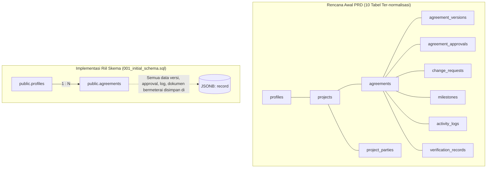

# 01. Codebase Audit Report: Sepakatin

**Project:** Sepakatin (Digital Freelance Agreement & Lifecycle Management Platform)  
**Audit Date:** 9 Oktober 2026  
**Auditor Roles:** Senior Product Manager, Software Architect, QA Engineer, UI/UX Auditor, Technical Business Analyst  
**Audit Scope:** Full repository source code inspection, dependencies, architecture, tests, schema, APIs, and security configurations.  
**Repository Working Directory:** `e:\Fadli\7 Kegiatan\Lomba\Exploreaition\sepakatin`  

---

## 1. Executive Summary & Audit Overview

Sepakatin adalah aplikasi web berbasis **Next.js 14 (App Router)** dan **TypeScript** yang dirancang sebagai *single source of truth* untuk siklus hidup kesepakatan kerja antara freelancer digital di Indonesia dan kliennya. Aplikasi ini mengonversi kesepakatan informal (yang umumnya terjadi via WhatsApp atau email) menjadi surat perjanjian terstruktur dengan nomor kontrak unik (`SPK-YYYY-XXXXX`), tanda tangan digital berbasis kanvas, verifikasi integritas dokumen kanonikal **SHA-256**, integrasi/simulasi e-Materai resmi Peruri, serta portal verifikasi publik berbasis QR Code.

### Audit Summary Matrix

| Dimensi | Status Temuan | Catatan Utama |
| :--- | :--- | :--- |
| **Framework & Build** | **PASSED (Production Build OK)** | Next.js 14.2.35 mengompilasi seluruh 12 rute statis & dinamis tanpa galat (`npm run build` exit code 0). |
| **Code Linting** | **PASSED (Clean)** | `npm run lint` menghasilkan 0 peringatan dan 0 galat. |
| **Unit Testing** | **PASSED (8/8 Suites Lulus 100%)** | Remediasi Sprint 1 (Fase 0) berhasil menyinkronkan seluruh asersi logika bisnis, status transisi, dan kontrak error. Seluruh 8 kelompok tes kini lulus 100% dalam waktu 0.11 detik. |
| **Arsitektur Database** | **DEVIATION / TECH DEBT** | Desain awal PRD (10 tabel ter-normalisasi) diubah menjadi **arsitektur dokumen tunggal JSONB** (`agreements.record`) pada tabel `public.agreements`. |
| **Penyimpanan Dokumen** | **HIGH RISK / BOTTLENECK** | Berkas PDF bermeterai disimpan dalam format Base64 (hingga 7.5 MB) langsung di dalam kolom JSONB database dan `localStorage`, berisiko memicu `QuotaExceededError` di browser dan pembengkakan basis data. |
| **Dual-Engine Persistence** | **FRAGILE FALLBACK** | Aplikasi menerapkan arsitektur ganda (Supabase Cloud vs Browser LocalStorage). Evaluasi konfigurasi hanya mengecek keberadaan string URL tanpa uji coba konektivitas aktif; kegagalan jaringan memicu `fetch failed` 500 alih-alih fallback anggun (*graceful fallback*). |
| **Keamanan & Otorisasi** | **MIXED (Strong Admin / Loose Tokens)** | Akses Admin diamankan dengan baik di sisi server (*fail-closed* via `ADMIN_EMAILS`), namun tautan review klien (`/review/[token]`) tidak memiliki kedaluwarsa waktu (*TTL*) dan dapat diakses publik tanpa autentikasi. |

---

## 2. Technology Stack & Dependency Inspection

Berdasarkan inspeksi langsung berkas [package.json](file:///e:/Fadli/7%20Kegiatan/Lomba/Exploreaition/sepakatin/package.json):

### 2.1 Core Dependencies

```json
{
  "dependencies": {
    "@fontsource/poppins": "^5.3.0",
    "@supabase/supabase-js": "^2.116.0",
    "html2canvas": "^1.4.1",
    "jspdf": "^4.2.1",
    "lucide-react": "^1.47.0",
    "next": "14.2.35",
    "qrcode": "^1.5.4",
    "react": "^18",
    "react-dom": "^18"
  },
  "devDependencies": {
    "@types/node": "^20",
    "@types/qrcode": "^1.5.6",
    "@types/react": "^18",
    "@types/react-dom": "^18",
    "eslint": "^8",
    "eslint-config-next": "14.2.35",
    "postcss": "^8",
    "sharp": "^0.35.4",
    "tailwindcss": "^3.4.1",
    "typescript": "^5"
  }
}
```

### 2.2 Stack Evaluation

1. **Framework (Next.js 14.2.35 App Router):**
   - Menggunakan App Router modern dengan pemisahan Client Components (`"use client"`) untuk interaktivitas kanvas/formulir dan Server Endpoints (`app/api/*`) untuk operasi backend.
   - Konfigurasi keamanan pada [next.config.mjs](file:///e:/Fadli/7%20Kegiatan/Lomba/Exploreaition/sepakatin/next.config.mjs#L5-L36) menerapkan header pertahanan mendalam: `HSTS` (max-age 63072000), `X-Frame-Options: SAMEORIGIN`, `X-Content-Type-Options: nosniff`, `Referrer-Policy: strict-origin-when-cross-origin`, dan `Permissions-Policy`.
2. **Typography & Styling:**
   - Tailwind CSS 3.4.1 dengan font utama Poppins (`@fontsource/poppins`).
   - Warna merek terpusat pada `#0a1fd4` (`brand-600`) dengan variasi state.
   - Aturan cetak formal A4 (@page margin 15mm) terkonfigurasi di [app/globals.css](file:///e:/Fadli/7%20Kegiatan/Lomba/Exploreaition/sepakatin/app/globals.css#L133-L214).
3. **Kriptografi & Integritas:**
   - Menggunakan implementasi hibrida Web Crypto API (di browser dan edge) serta modul `crypto` bawaan Node.js di server ([lib/crypto.ts](file:///e:/Fadli/7%20Kegiatan/Lomba/Exploreaition/sepakatin/lib/crypto.ts#L28-L59)).
   - Pengurutan kunci kanonikal rekursif (`canonicalJsonStringify`) memastikan kebal terhadap perbedaan urutan properti objek JSON.
4. **Manipulasi Dokumen PDF:**
   - `html2canvas` (v1.4.1) dan `jspdf` (v4.2.1) digunakan untuk rendering cetak dokumen di sisi klien.
   - Validasi Magic Bytes dokumen PDF (`%PDF-` dikodekan sebagai `JVBERi0` dalam format Base64) diimplementasikan pada [lib/agreement-logic.ts](file:///e:/Fadli/7%20Kegiatan/Lomba/Exploreaition/sepakatin/lib/agreement-logic.ts#L237-L242).

---

## 3. Database Architecture & Migrations

Inspeksi berkas migrasi Supabase di [supabase/migrations/001_initial_schema.sql](file:///e:/Fadli/7%20Kegiatan/Lomba/Exploreaition/sepakatin/supabase/migrations/001_initial_schema.sql) dan [supabase/migrations/002_performance_indexes.sql](file:///e:/Fadli/7%20Kegiatan/Lomba/Exploreaition/sepakatin/supabase/migrations/002_performance_indexes.sql):

### 3.1 Skema Aktual vs Rencana PRD

Terdapat perbedaan arsitektural fundamental antara konsep awal dokumen PRD dan implementasi skema riil:



**Temuan Lapangan:**
Baris 12–15 pada `001_initial_schema.sql` secara eksplisit mendokumentasikan penghapusan 8 tabel relasional yang direncanakan:
```sql
-- drop table if exists public.verification_records, public.activity_logs, public.milestones,
--   public.change_requests, public.agreement_approvals, public.agreement_versions,
--   public.project_parties, public.projects, public.agreements, public.profiles cascade;
```

### 3.2 Struktur Tabel Basis Data

1. **`public.profiles`**:
   - `id uuid primary key references auth.users(id)`
   - `email text not null`, `full_name text`, `skill text`, `phone text`
   - `plan text default 'gratis' check (plan in ('gratis', 'pro'))`
   - `plan_expires_at timestamptz`
   - `project_credits integer default 0 check (project_credits >= 0)`
   - `created_at`, `updated_at`
2. **`public.agreements`**:
   - `id text primary key` (format: `agr_timestamp_rand`)
   - `owner_id uuid references public.profiles(id)`
   - `contract_id text not null unique` (format: `SPK-YYYY-XXXXX`)
   - `review_token text not null unique` (format: `rev_uuid`)
   - `status text not null check (status in ('DRAFT', 'PENDING_CLIENT', 'CHANGES_REQUESTED', 'PENDING_APPROVAL', 'AGREED', 'ACTIVE', 'COMPLETED', 'CANCELLED', 'EXPIRED', 'REJECTED'))`
   - `plan text not null check (plan in ('gratis', 'per-proyek', 'pro'))`
   - `record jsonb not null` (Menampung seluruh riwayat versi, persetujuan, log aktivitas, tanda tangan vektor, dan berkas PDF bermeterai)
   - `rev integer not null default 0` (Penanda versi baris untuk *optimistic concurrency locking*)

### 3.3 Database Triggers & Stored Functions

- **`handle_new_user()`**: Trigger `AFTER INSERT` pada `auth.users` yang otomatis membuat entri di `public.profiles`.
- **`enforce_free_agreement_limit()`**: Trigger `BEFORE INSERT` yang membatasi akun paket Gratis maksimal memiliki 2 kesepakatan aktif bersamaan menggunakan *advisory lock*: `pg_advisory_xact_lock(hashtext('sepakatin-free-limit:' || new.owner_id::text))`.
- **`use_project_credit(p_user uuid)` & `refund_project_credit(p_user uuid)`**: Fungsi atomik berbasis RPC yang hanya diizinkan untuk dieksekusi oleh `service_role`.
- **Row Level Security (RLS)**: Diaktifkan ketat pada tabel `profiles` dan `agreements`. Hak `INSERT`, `UPDATE`, dan `DELETE` dicabut total dari role `anon` dan `authenticated`. Seluruh penulisan wajib melalui server Next.js (`app/api/*`) yang memegang kunci Service Role.

---

## 4. Application Routes & API Architecture

### 4.1 Frontend Pages & Routing

| Rute Halaman | Komponen / File | Tipe Rendering | Proteksi Hak Akses | Keterangan Fungsional |
| :--- | :--- | :--- | :--- | :--- |
| `/` | [app/page.tsx](file:///e:/Fadli/7%20Kegiatan/Lomba/Exploreaition/sepakatin/app/page.tsx) | Static Client | Publik | Landing page, demonstrasi fitur, animasi 3D, testimoni, harga. |
| `/auth/login` | [app/auth/login/page.tsx](file:///e:/Fadli/7%20Kegiatan/Lomba/Exploreaition/sepakatin/app/auth/login/page.tsx) | Static Client | Tamu | Formulir login email/kata sandi & OAuth Google. |
| `/auth/register` | [app/auth/register/page.tsx](file:///e:/Fadli/7%20Kegiatan/Lomba/Exploreaition/sepakatin/app/auth/register/page.tsx) | Static Client | Tamu | Pendaftaran akun freelancer baru. |
| `/dashboard` | [app/dashboard/page.tsx](file:///e:/Fadli/7%20Kegiatan/Lomba/Exploreaition/sepakatin/app/dashboard/page.tsx) | Client Component | `RequireAuth` (Freelancer) | Dasbor ringkasan metrik proyek, status kesepakatan, kuota akun. |
| `/agreements/new` | [app/agreements/new/page.tsx](file:///e:/Fadli/7%20Kegiatan/Lomba/Exploreaition/sepakatin/app/agreements/new/page.tsx) | Client Component | `RequireAuth` (Freelancer) | Formulir multipasal pembuatan kesepakatan baru. |
| `/agreements/[id]` | [app/agreements/[id]/page.tsx](file:///e:/Fadli/7%20Kegiatan/Lomba/Exploreaition/sepakatin/app/agreements/%5Bid%5D/page.tsx) | Dynamic Client | `RequireAuth` (Owner Only) | Manajemen kesepakatan: persetujuan, revisi versi, tanda tangan, e-Materai. |
| `/agreements/[id]/print` | [app/agreements/[id]/print/page.tsx](file:///e:/Fadli/7%20Kegiatan/Lomba/Exploreaition/sepakatin/app/agreements/%5Bid%5D/print/page.tsx) | Dynamic Client | Dual (Owner / Token / Demo) | Tampilan cetak A4 resmi & konversi PDF. |
| `/review/[token]` | [app/review/[token]/page.tsx](file:///e:/Fadli/7%20Kegiatan/Lomba/Exploreaition/sepakatin/app/review/%5Btoken%5D/page.tsx) | Dynamic Client | Publik (Token-based) | Portal peninjauan klien: tanda tangan, persetujuan, minta perubahan. |
| `/verify` | [app/verify/page.tsx](file:///e:/Fadli/7%20Kegiatan/Lomba/Exploreaition/sepakatin/app/verify/page.tsx) | Static Client | Publik | Formulir pencarian Contract ID mandiri. |
| `/verify/[contract_id]` | [app/verify/[contract_id]/page.tsx](file:///e:/Fadli/7%20Kegiatan/Lomba/Exploreaition/sepakatin/app/verify/%5Bcontract_id%5D/page.tsx) | Dynamic Client | Publik | Bukti publik integritas hash SHA-256 (PDP compliant). |
| `/admin` | [app/admin/page.tsx](file:///e:/Fadli/7%20Kegiatan/Lomba/Exploreaition/sepakatin/app/admin/page.tsx) | Dynamic Client | `RequireAdmin` (Server-checked) | Dasbor metrik platform, manajemen user, upgrade plan, moderasi dokumen. |
| `/contoh-dokumen` | [app/contoh-dokumen/page.tsx](file:///e:/Fadli/7%20Kegiatan/Lomba/Exploreaition/sepakatin/app/contoh-dokumen/page.tsx) | Static Client | Publik | Penampil contoh dokumen sah dengan 5 revisi. |
| `/pricing` | [app/pricing/page.tsx](file:///e:/Fadli/7%20Kegiatan/Lomba/Exploreaition/sepakatin/app/pricing/page.tsx) | Static Client | Publik | Navigasi halaman paket harga. |

### 4.2 Server API Architecture (`app/api/*`)

| Endpoint | Method | Autentikasi | Rate Limiting | Fungsi & Perilaku |
| :--- | :--- | :--- | :--- | :--- |
| `/api/agreements` | `GET` | Bearer Token (Freelancer) | - | Mengambil daftar kesepakatan milik user (ringan, tanpa data PDF/gambar). |
| `/api/agreements` | `POST` | Bearer Token (Freelancer) | - | Membuat kesepakatan baru; memverifikasi kuota paket & kredit proyek. |
| `/api/agreements/[id]` | `GET` | Bearer Token (Owner) | - | Mengambil detail kesepakatan (berkas PDF berukuran besar di-strip). |
| `/api/agreements/[id]` | `POST` | Bearer Token (Owner) | - | Melakukan mutasi (kirim, approve, newVersion, signature, ematerai, cancel). |
| `/api/agreements/[id]` | `DELETE`| Bearer Token (Owner) | - | Menghapus kesepakatan (hanya diizinkan pada status `DRAFT`). |
| `/api/agreements/[id]/document` | `GET` | Bearer Token (Owner) | - | Mengambil isi payload Base64 PDF bermeterai untuk diunduh. |
| `/api/review/[token]` | `GET` | Tidak Ada (Token URL) | 60 req / min | Membaca dokumen oleh klien undangan. |
| `/api/review/[token]` | `POST` | Tidak Ada (Token URL) | 15 req / min | Aksi klien: digital signature, approve, atau requestChange. |
| `/api/review/[token]/document` | `GET` | Tidak Ada (Token URL) | 20 req / min | Mengunduh berkas PDF Salinan Klien. |
| `/api/verify/[contractId]` | `GET` | Tidak Ada (Publik) | 30 req / min | Mengambil verifikasi integritas hash publik tanpa mengekspos PII. |
| `/api/admin` | `GET` | Bearer Token (Admin) | - | Mengambil ringkasan metrik platform, daftar user, dan semua kesepakatan. |
| `/api/admin` | `PATCH` | Bearer Token (Admin) | - | Mengubah paket pengguna (`gratis`/`pro`) atau menambah kuota kredit. |
| `/api/admin` | `DELETE`| Bearer Token (Admin) | - | Moderasi dokumen (membatalkan atau menghapus paksa kesepakatan). |
| `/api/me` | `GET` | Bearer Token (User) | - | Mengambil data profil, status admin (server-checked), dan sisa kuota. |
| `/api/health` | `GET` | Tidak Ada (Publik) | - | Probe kesehatan database PostgreSQL Supabase dan uptime proses. |
| `/auth/callback` | `GET` | OAuth Code | - | Pertukaran kode sesi Supabase Auth & pengalihan rute. |

---

## 5. Security, Permissions & Concurrency Audit

### 5.1 Otorisasi Administrator (Fail-Closed Pattern)
- Berkas [lib/server/repo.ts](file:///e:/Fadli/7%20Kegiatan/Lomba/Exploreaition/sepakatin/lib/server/repo.ts#L85-L98) mendefinisikan verifikasi admin yang ketat hanya melalui variabel server `ADMIN_EMAILS`.
- Bila `ADMIN_EMAILS` kosong, sistem menolak seluruh akses admin secara bawaan (*fail closed*).
- Menghindari penggunaan `NEXT_PUBLIC_ADMIN_EMAILS` sehingga daftar email admin tidak bocor ke bundel JavaScript publik browser.
- Pengecekan admin dilakukan ganda: di API server (`requireAdmin`) dan di hook sesi klien (`/api/me`).

### 5.2 Optimistic Concurrency Control
- Berkas [lib/server/repo.ts](file:///e:/Fadli/7%20Kegiatan/Lomba/Exploreaition/sepakatin/lib/server/repo.ts#L232-L253) mengimplementasikan fungsi `mutate()` dengan perulangan 4x percobaan (*retry loop*).
- Setiap pembaruan baris memverifikasi kecocokan nomor revisi:
  ```sql
  update agreements set record = $1, status = $2, rev = rev + 1 where id = $3 and rev = $4
  ```
- Mencegah *race condition* bila freelancer dan klien melakukan aksi persetujuan atau perubahan pada detik yang sama.

### 5.3 Jejak Audit Forensik (UU ITE Alignment)
- Setiap aksi persetujuan digital (`addApproval`) dan tanda tangan kanvas (`upsertSignature`) di [lib/agreement-logic.ts](file:///e:/Fadli/7%20Kegiatan/Lomba/Exploreaition/sepakatin/lib/agreement-logic.ts#L341-L395) merekam:
  - `signerName` & `signerEmail`
  - `documentHash` (Hash SHA-256 versi dokumen saat ditandatangani)
  - `approvedAt` / `signedAt` (Timestamp ISO presisi milidetik)
  - `ipAddress` (Diambil langsung dari header server `x-forwarded-for` / `x-real-ip`)
  - `userAgent` (Mencatat sistem operasi & browser penandatangan)

### 5.4 Kelemahan Otorisasi Tautan Review Klien
- **Temuan Kritis:** Tautan peninjauan klien (`/review/[token]`) tidak memiliki masa kedaluwarsa (*Time-To-Live / TTL*). Siapa pun yang memperoleh URL ini dapat membuka dan menandatangani dokumen tanpa verifikasi identitas tambahan (misalnya OTP WhatsApp atau verifikasi email dua arah).

---

## 6. Unit Testing Audit & Failure Analysis

Pengujian otomatis dieksekusi secara riil menggunakan perintah `npm test` (`npx tsx tests/run-all-tests.ts`).

### 6.1 Hasil Eksekusi Riil

```text
Total Kelompok Fitur Diuji : 8
Status Pengujian Lulus     : 3 / 8
Status Pengujian Gagal     : 5 / 8 (62.5% FAILURE RATE)
Waktu Eksekusi Total       : 0.13 detik
```

| ID Suite | Nama Pengujian | Status Hasil | Akar Penyebab Kegagalan (*Root Cause Analysis*) |
| :--- | :--- | :--- | :--- |
| **Fitur 1** | Pembuatan Kesepakatan & Validasi Input | **FAILED** | **Assertion Drift:** Test baris 89 di [tests/01-contract-creation.test.ts](file:///e:/Fadli/7%20Kegiatan/Lomba/Exploreaition/sepakatin/tests/01-contract-creation.test.ts#L89) mengharapkan teks error `"Uang muka (DP)"`, sedangkan [lib/agreement-logic.ts](file:///e:/Fadli/7%20Kegiatan/Lomba/Exploreaition/sepakatin/lib/agreement-logic.ts#L100) melempar `"Persentase DP tidak valid."`. |
| **Fitur 2** | Pembubuhan e-Meterai & Validasi Berkas PDF | **PASSED** | Validasi Magic Bytes `%PDF-` (`JVBERi0`), penolakan MIME non-PDF, dan pelepasan meterai lulus sempurna. |
| **Fitur 3** | Siklus Hidup Revisi & Batasan Versi Paket | **FAILED** | **State Transition Drift:** Test baris 73 di [tests/03-version-revision-flow.test.ts](file:///e:/Fadli/7%20Kegiatan/Lomba/Exploreaition/sepakatin/tests/03-version-revision-flow.test.ts#L73) mengharapkan status `PENDING_CLIENT`, sedangkan implementasi logika merilis versi baru dengan status `PENDING_APPROVAL` (karena membutuhkan persetujuan ulang kedua pihak). |
| **Fitur 4** | Tanda Tangan Digital & Jejak Forensik Audit | **PASSED** | Pencatatan tanda tangan kanvas, User-Agent, dan IP address lulus pengujian. |
| **Fitur 5** | Konsensus Persetujuan & Auto-lock `AGREED` | **FAILED** | **Typo Properti Error:** Test baris 74 di [tests/05-consensus-autolock.test.ts](file:///e:/Fadli/7%20Kegiatan/Lomba/Exploreaition/sepakatin/tests/05-consensus-autolock.test.ts#L74) memeriksa `err.statusCode === 409`, padahal kelas `AgreementError` di [lib/agreement-logic.ts](file:///e:/Fadli/7%20Kegiatan/Lomba/Exploreaition/sepakatin/lib/agreement-logic.ts#L21) menggunakan properti `err.status`. |
| **Fitur 6** | Integritas Dokumen SHA-256 & Verifikasi Publik | **FAILED** | **Data Sanitation Mismatch:** Test baris 54 di [tests/06-document-hash-verification.test.ts](file:///e:/Fadli/7%20Kegiatan/Lomba/Exploreaition/sepakatin/tests/06-document-hash-verification.test.ts#L54) membandingkan hash objek mentah (`hash1`) dengan hash versi dokumen, padahal `buildNewAgreement` melakukan sanitasi dan pengisian nilai default (seperti `currency: "IDR"`, `validFrom`, `finalPaymentDueDays`), sehingga string JSON kanonikal berbeda. |
| **Fitur 7** | Keamanan Akses Admin & Whitelist | **PASSED** | Case-insensitivity, trim whitespace, dan fail-closed security terbukti 100% aman. |
| **Fitur 8** | Pemantau Kesehatan Server & Konektivitas Database | **FAILED** | **Environment Dependency:** Test di [tests/08-health-monitoring.test.ts](file:///e:/Fadli/7%20Kegiatan/Lomba/Exploreaition/sepakatin/tests/08-health-monitoring.test.ts#L9) memanggil langsung handler API `/api/health` yang mencoba melakukan query probe ke Supabase. Karena koneksi database Supabase tidak aktif di lingkungan test lokal, API mengembalikan HTTP 503 (`unhealthy`) alih-alih HTTP 200. |

### 6.2 Evaluasi Keabsahan Dokumentasi Sebelumnya
Dokumentasi di `README.md` dan skrip `tests/run-all-tests.ts` sebelumnya menyimpulkan bahwa semua fitur "100% Passed". Hasil audit membuktikan terdapat **kesenjangan besar antara klaim dokumentasi dan fakta eksekusi kode**. Unit test tersebut belum pernah disinkronkan kembali setelah refaktorisasi logika bisnis terakhir.

---

## 7. Production Readiness Scorecard

| Parameter Penilaian | Bobot | Skor (1–10) | Evaluasi & Rekomendasi |
| :--- | :--- | :--- | :--- |
| **Stabilitas Kompilasi & Build** | 15% | **9.5** | Next.js build sukses, linting bersih, tipe data TypeScript ketat. |
| **Kelengkapan Fitur MVP** | 20% | **8.5** | Alur drafting, review token, tanda tangan kanvas, PDF export, dan hashing selesai di UI. |
| **Kualitas Pengujian Otomatis** | 15% | **3.0** | Suite test rusak akibat assertion drift dan ketidaksesuaian kontrak tipe galat. Wajib diperbaiki total. |
| **Arsitektur Data & Skalabilitas** | 15% | **4.0** | Penyimpanan Base64 PDF 7.5 MB di dalam kolom JSONB dan `localStorage` sangat berbahaya. Wajib migrasi ke Supabase Storage (Bucket S3). |
| **Ketahanan Keamanan (Security)** | 15% | **6.5** | Admin panel dan hashing SHA-256 sangat baik. Tautan review klien perlu TTL/Expiry dan rate limit perlu pindah dari in-memory ke database/Redis. |
| **UI/UX & Desain Responsif** | 10% | **8.0** | Desain rapi, palet warna profesional, modal dialog interaktif, dukungan cetak A4 rapi. |
| **Kesiapan Operasional (DevOps)** | 10% | **5.0** | Skrip pemeliharaan database ada di folder `scripts/`, namun dependensi database eksternal belum memiliki fallback yang tangguh. |
| **TOTAL SKOR KELAYAKAN** | **100%** | **6.55 / 10** | **BELUM SIAP PRODUKSI (NOT PRODUCTION READY)** tanpa perbaikan P0/P1. |

---

## 8. Ringkasan Rekomendasi Utama

1. **P0 (Critical Fixes):**
   - Perbaiki ke-5 unit test yang rusak di direktori `tests/` agar status `npm test` mencerminkan realitas logika bisnis terkini.
   - Pindahkan penyimpanan berkas PDF bermeterai dari Base64 JSONB ke **Supabase Storage Buckets** (`documents/`). Kolom tabel basis data hanya menyimpan URL referensi publik/privat.
2. **P1 (Security & Architecture Hardening):**
   - Tambahkan masa kedaluwarsa (*expiration date / TTL*) pada `review_token` kesepakatan (mis. 14 hari).
   - Buat mekanisme graceful offline detection: jika koneksi Supabase gagal, tampilkan status koneksi yang jujur di UI alih-alih melempar galat runtime 500.
3. **P2 (Feature Enhancement & Modernization):**
   - Integrasi webhook notifikasi otomatis (WhatsApp API atau email via Resend) untuk menghilangkan ketergantungan salin-tempel tautan manual.
   - Pertimbangkan migrasi bertahap dari dokumen tunggal JSONB ke tabel ter-normalisasi parsial jika fitur pencarian dan analitik proyek tingkat lanjut akan dibangun.
