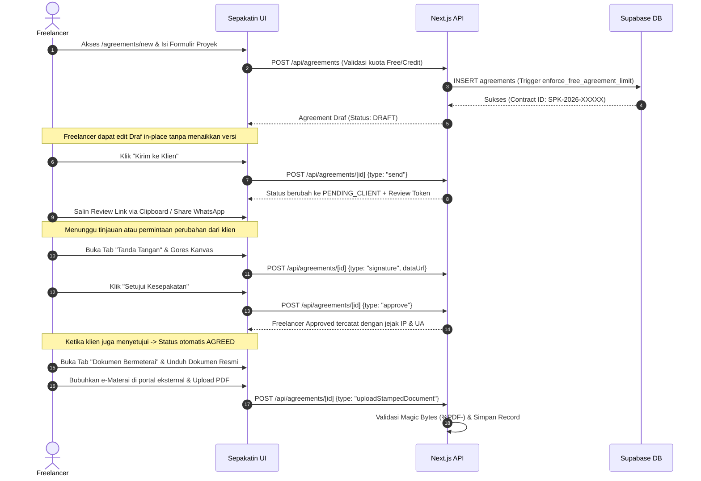
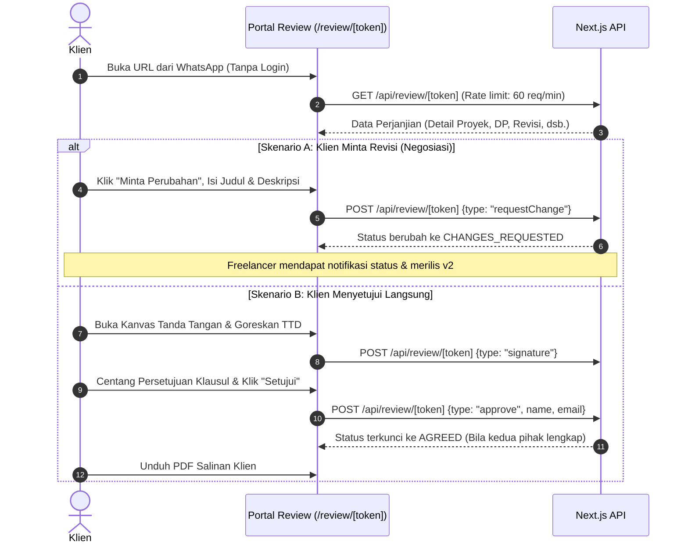
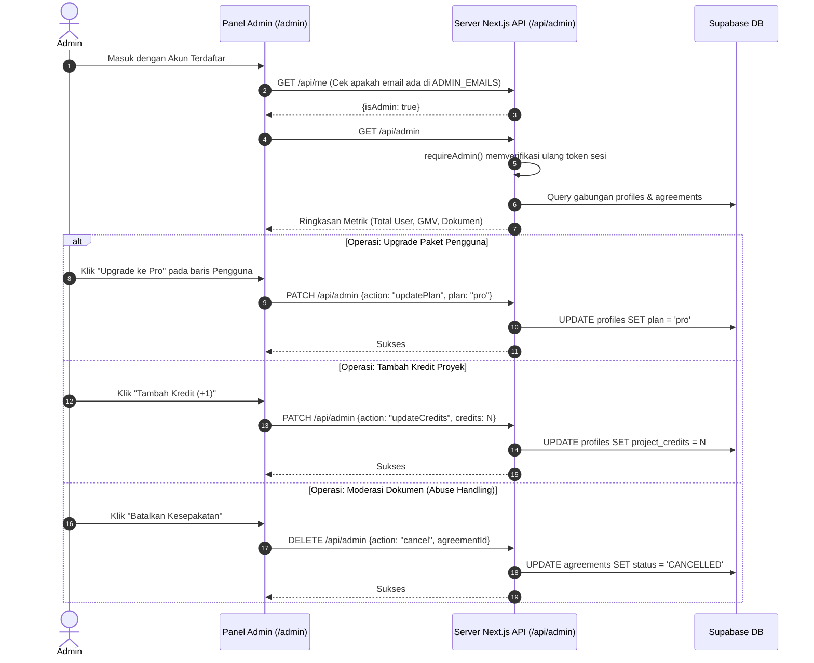
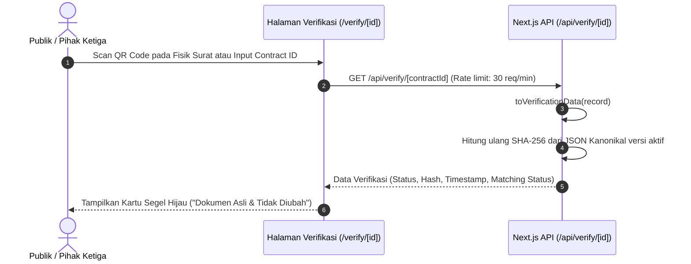

# 02. Feature Inventory & User Journey Audit: Sepakatin

**Project:** Sepakatin  
**Auditor Roles:** Senior Product Manager, Software Architect, QA Engineer, UI/UX Auditor, Technical Business Analyst  
**Audit Scope:** End-to-end verification of user journeys, feature implementation states, evidence sources, and technical behavior.  
**Repository Working Directory:** `e:\Fadli\7 Kegiatan\Lomba\Exploreaition\sepakatin`  

---

## 1. Feature Implementation Status Matrix

Status klasifikasi fitur didasarkan pada bukti riil kode sumber (*primary evidence*):
- **Implemented:** Kode UI, logika backend, validasi, dan penyimpanan data selesai dan beroperasi.
- **Partially Implemented:** Fitur dapat digunakan namun memiliki batasan kritis, dependensi yang rapuh, atau hanya berjalan pada mode tertentu.
- **Unverified:** Kode ada tetapi belum dapat diverifikasi secara fungsional di lingkungan produksi/nyata (misalnya integrasi pihak ketiga eksternal).
- **Missing:** Disebutkan pada dokumentasi/konsep PRD atau UI lama, tetapi tidak ada implementasi fungsionalnya dalam kode saat ini.

| ID Fitur | Modul / Fitur | Status Implementasi | Sumber Bukti Kode | Catatan & Realitas Fungsional |
| :--- | :--- | :--- | :--- | :--- |
| **FEAT-001** | Autentikasi Pengguna (Email + Sandi) | **Implemented** | [lib/auth.ts:267-339](file:///e:/Fadli/7%20Kegiatan/Lomba/Exploreaition/sepakatin/lib/auth.ts#L267-L339) [app/auth/login/page.tsx](file:///e:/Fadli/7%20Kegiatan/Lomba/Exploreaition/sepakatin/app/auth/login/page.tsx) | Mendukung Supabase Auth & LocalStorage fallback. Validasi format email & batas sandi min. 6 karakter. |
| **FEAT-002** | Autentikasi OAuth Google | **Partially Implemented** | [lib/auth.ts:341-354](file:///e:/Fadli/7%20Kegiatan/Lomba/Exploreaition/sepakatin/lib/auth.ts#L341-L354) [app/auth/callback/route.ts](file:///e:/Fadli/7%20Kegiatan/Lomba/Exploreaition/sepakatin/app/auth/callback/route.ts) | Kode handler OAuth ada, namun hanya aktif jika kredensial Supabase terpasang dan Google Provider diaktifkan di dasbor Supabase. |
| **FEAT-003** | Smart Agreement Builder (Formulir Multi-Pasal) | **Implemented** | [app/agreements/new/page.tsx](file:///e:/Fadli/7%20Kegiatan/Lomba/Exploreaition/sepakatin/app/agreements/new/page.tsx) [lib/agreement-logic.ts:88-211](file:///e:/Fadli/7%20Kegiatan/Lomba/Exploreaition/sepakatin/lib/agreement-logic.ts#L88-L211) | Formulir terstruktur mencakup identitas para pihak, lingkup (deliverables & exclusions), skema bayar (DP & termin), revisi, HKI, terminasi. Sanitasi input ketat. |
| **FEAT-004** | Dual-Engine Store (Supabase + LocalStorage) | **Partially Implemented** | [lib/store.ts:46-140](file:///e:/Fadli/7%20Kegiatan/Lomba/Exploreaition/sepakatin/lib/store.ts#L46-L140) [lib/supabase.ts:7-16](file:///e:/Fadli/7%20Kegiatan/Lomba/Exploreaition/sepakatin/lib/supabase.ts#L7-L16) | Berjalan lancar di LocalStorage, tetapi pengecekan koneksi Supabase bersifat statis (hanya string URL); bila cloud Supabase unreachable, gagal total dengan error 500. |
| **FEAT-005** | Frictionless Client Review (Token-based) | **Implemented** | [app/review/[token]/page.tsx](file:///e:/Fadli/7%20Kegiatan/Lomba/Exploreaition/sepakatin/app/review/%5Btoken%5D/page.tsx) [app/api/review/[token]/route.ts](file:///e:/Fadli/7%20Kegiatan/Lomba/Exploreaition/sepakatin/app/api/review/%5Btoken%5D/route.ts) | Klien meninjau dokumen tanpa perlu login/daftar akun. Rate limited di API server (60 req/min GET, 15 req/min POST). |
| **FEAT-006** | Digital Signature Canvas (Vector Drawing) | **Implemented** | [components/SignaturePad.tsx](file:///e:/Fadli/7%20Kegiatan/Lomba/Exploreaition/sepakatin/components/SignaturePad.tsx) [lib/agreement-logic.ts:372-395](file:///e:/Fadli/7%20Kegiatan/Lomba/Exploreaition/sepakatin/lib/agreement-logic.ts#L372-L395) | Kanvas HTML5 2D, warna royal blue `#0a187a`, touch-friendly mobile, simpan Base64 PNG. Tanda tangan terikat ke versi spesifik. |
| **FEAT-007** | Jejak Forensik UU ITE (Audit Trail) | **Implemented** | [lib/agreement-logic.ts:341-365](file:///e:/Fadli/7%20Kegiatan/Lomba/Exploreaition/sepakatin/lib/agreement-logic.ts#L341-L365) [app/agreements/[id]/page.tsx:55-67](file:///e:/Fadli/7%20Kegiatan/Lomba/Exploreaition/sepakatin/app/agreements/%5Bid%5D/page.tsx#L55-L67) | Merekam IP pemohon dari header proxy (`x-forwarded-for`/`x-real-ip`), User-Agent, nama, email, dan timestamp ISO saat approval & penandatanganan. |
| **FEAT-008** | Client Change Request & Negotiation | **Implemented** | [app/review/[token]/page.tsx:49-53](file:///e:/Fadli/7%20Kegiatan/Lomba/Exploreaition/sepakatin/app/review/%5Btoken%5D/page.tsx#L49-L53) [lib/agreement-logic.ts:613-646](file:///e:/Fadli/7%20Kegiatan/Lomba/Exploreaition/sepakatin/lib/agreement-logic.ts#L613-L646) | Klien mengajukan revisi dengan judul & deskripsi. Status beralih ke `CHANGES_REQUESTED`. Dibatasi maksimal 3 permintaan menggantung (*open requests*). |
| **FEAT-009** | Version Bumping & Immutability Lock | **Implemented** | [lib/agreement-logic.ts:419-473](file:///e:/Fadli/7%20Kegiatan/Lomba/Exploreaition/sepakatin/lib/agreement-logic.ts#L419-L473) [app/agreements/[id]/page.tsx:100-107](file:///e:/Fadli/7%20Kegiatan/Lomba/Exploreaition/sepakatin/app/agreements/%5Bid%5D/page.tsx#L100-L107) | Edit status `DRAFT` dilakukan *in-place*. Setelah dikirim/direvisi, perubahan memicu versi baru (`v2`, `v3`). Ketika kedua pihak menyetujui, terkunci ke `AGREED` secara immutable. |
| **FEAT-010** | Segel Integritas SHA-256 (Canonical JSON) | **Implemented** | [lib/crypto.ts:8-59](file:///e:/Fadli/7%20Kegiatan/Lomba/Exploreaition/sepakatin/lib/crypto.ts#L8-L59) [lib/agreement-logic.ts:666-689](file:///e:/Fadli/7%20Kegiatan/Lomba/Exploreaition/sepakatin/lib/agreement-logic.ts#L666-L689) | Menghasilkan hash SHA-256 heksadesimal 64 karakter dari JSON kanonikal terurut. Perubahan data Rp1 mengubah total hash (*avalanche effect*). |
| **FEAT-011** | Dynamic Verification QR Code & Halaman Publik | **Implemented** | [components/QRCodeViewer.tsx](file:///e:/Fadli/7%20Kegiatan/Lomba/Exploreaition/sepakatin/components/QRCodeViewer.tsx) [app/verify/[contract_id]/page.tsx](file:///e:/Fadli/7%20Kegiatan/Lomba/Exploreaition/sepakatin/app/verify/%5Bcontract_id%5D/page.tsx) | Menampilkan QR Code dinamis menunjuk ke domain permanen `NEXT_PUBLIC_APP_URL/verify/[contractId]`. Menampilkan status verifikasi hash tanpa mengekspos PII atau token. |
| **FEAT-012** | e-Materai Simulasi / Penempelan Stamp | **Implemented** | [lib/agreement-logic.ts:520-564](file:///e:/Fadli/7%20Kegiatan/Lomba/Exploreaition/sepakatin/lib/agreement-logic.ts#L520-L564) [components/PrintableAgreement.tsx:52-56](file:///e:/Fadli/7%20Kegiatan/Lomba/Exploreaition/sepakatin/components/PrintableAgreement.tsx#L52-L56) | Simulasi penempelan gambar e-Materai Rp10.000 dengan nomor seri (SN) pada salinan freelancer, klien, atau keduanya. |
| **FEAT-013** | Pengunggahan PDF Resmi Bermeterai (Peruri) | **Partially Implemented** | [lib/agreement-logic.ts:474-506](file:///e:/Fadli/7%20Kegiatan/Lomba/Exploreaition/sepakatin/lib/agreement-logic.ts#L474-L506) [lib/server/repo.ts:151-176](file:///e:/Fadli/7%20Kegiatan/Lomba/Exploreaition/sepakatin/lib/server/repo.ts#L151-L176) | Validasi Magic Bytes `%PDF-` (`JVBERi0`) berfungsi sangat baik. Namun file PDF disimpan dalam bentuk Base64 di dalam baris JSONB database / LocalStorage, berisiko melampaui kuota memory. |
| **FEAT-014** | Pixel-Perfect A4 Print Layout & Client-side PDF | **Implemented** | [components/PrintableAgreement.tsx:91-140](file:///e:/Fadli/7%20Kegiatan/Lomba/Exploreaition/sepakatin/components/PrintableAgreement.tsx#L91-L140) [app/agreements/[id]/print/page.tsx](file:///e:/Fadli/7%20Kegiatan/Lomba/Exploreaition/sepakatin/app/agreements/%5Bid%5D/print/page.tsx) | Tata letak A4 resmi (@page 15mm margin) rapi. Konversi html2canvas/jsPDF tersedia jika berkas bermeterai resmi belum diunggah. |
| **FEAT-015** | Batasan Paket Akun (Gratis, Per-Proyek, Pro) | **Implemented** | [lib/plans.ts:21-49](file:///e:/Fadli/7%20Kegiatan/Lomba/Exploreaition/sepakatin/lib/plans.ts#L21-L49) [supabase/migrations/001_initial_schema.sql:88-116](file:///e:/Fadli/7%20Kegiatan/Lomba/Exploreaition/sepakatin/supabase/migrations/001_initial_schema.sql#L88-L116) | Ditegakkan ganda: di TypeScript dan di database trigger PostgreSQL (`enforce_free_agreement_limit`). Maks. 2 kesepakatan gratis aktif, maks. 2 versi (1 kali revisi). |
| **FEAT-016** | Panel Admin Komprehensif | **Implemented** | [app/admin/page.tsx](file:///e:/Fadli/7%20Kegiatan/Lomba/Exploreaition/sepakatin/app/admin/page.tsx) [app/api/admin/route.ts](file:///e:/Fadli/7%20Kegiatan/Lomba/Exploreaition/sepakatin/app/api/admin/route.ts) | Ringkasan metrik real-time, audit pengguna, upgrade paket ke Pro, penambahan kredit per-proyek, dan moderasi pembatalan kesepakatan. Server whitelist fail-closed. |
| **FEAT-017** | Notifikasi Otomatis (WhatsApp API / Email) | **Missing** | [lib/contact.ts](file:///e:/Fadli/7%20Kegiatan/Lomba/Exploreaition/sepakatin/lib/contact.ts) [lib/clipboard.ts](file:///e:/Fadli/7%20Kegiatan/Lomba/Exploreaition/sepakatin/lib/clipboard.ts) | Tidak ada integrasi webhook atau API gateway pesan. Pengiriman link sepenuhnya bergantung pada salin-tempel manual atau klik tautan `wa.me` di browser pengguna. |
| **FEAT-018** | Pembayaran Online Gateway (Midtrans/Xendit) | **Missing** | [lib/plans.ts:58-106](file:///e:/Fadli/7%20Kegiatan/Lomba/Exploreaition/sepakatin/lib/plans.ts#L58-L106) [lib/contact.ts:12-16](file:///e:/Fadli/7%20Kegiatan/Lomba/Exploreaition/sepakatin/lib/contact.ts#L12-L16) | Tombol CTA paket mengarahkan ke chat WhatsApp Admin. Upgrade paket dan isi ulang kredit harus dilakukan manual oleh Admin di `/admin`. |
| **FEAT-019** | Integrasi API Resmi Peruri / Pos Fin | **Unverified / Missing** | [README.md:58](file:///e:/Fadli/7%20Kegiatan/Lomba/Exploreaition/sepakatin/README.md#L58) | Tidak ada koneksi API langsung ke distributor e-Meterai resmi. Pengguna diarahkan untuk membubuhkan meterai manual di portal eksternal Peruri lalu mengunggahnya kembali. |
| **FEAT-020** | Health Check & Observability Probe | **Partially Implemented** | [app/api/health/route.ts](file:///e:/Fadli/7%20Kegiatan/Lomba/Exploreaition/sepakatin/app/api/health/route.ts) | Endpoint probe tersedia (`uptimeSeconds`, `database.latencyMs`), namun melempar status 503 saat basis data offline tanpa mekanisme degradasi informasi. |

---

## 2. End-to-End User Journeys Tracing

### 2.1 Perjalanan Pengguna: Freelancer (Primary Persona)

**Temuan Lapangan Freelancer Journey:**
1. **Pencegahan Data Loss:** Selama status `DRAFT`, pengeditan formulir tidak menaikkan nomor versi atau menghabiskan kuota revisi gratis ([lib/agreement-logic.ts:423-439](file:///e:/Fadli/7%20Kegiatan/Lomba/Exploreaition/sepakatin/lib/agreement-logic.ts#L423-L439)).
2. **Ketergantungan Clipboard:** Jika browser memblokir Clipboard API (misalnya pada in-app browser non-HTTPS), sistem memiliki fallback `legacyCopy` di [lib/clipboard.ts:13-31](file:///e:/Fadli/7%20Kegiatan/Lomba/Exploreaition/sepakatin/lib/clipboard.ts#L13-L31) dan dialog peringatan eksplisit agar link tidak dianggap sudah tersalin padahal belum.

---

### 2.2 Perjalanan Pengguna: Klien (Invited Participant Persona)

**Temuan Lapangan Client Journey:**
1. **Frictionless Experience:** Sangat mulus karena klien tidak diwajibkan mendaftar akun atau memasukkan kata sandi.
2. **Resiko Keamanan Token:** Token review tidak memiliki batas waktu kedaluwarsa (*no TTL*). Tautan ini dapat diakses kapan saja di masa depan, bahkan setelah proyek selesai.
3. **Proteksi Spam Permintaan:** Dibendung oleh batasan `MAX_OPEN_CHANGE_REQUESTS = 3` di [lib/agreement-logic.ts:68](file:///e:/Fadli/7%20Kegiatan/Lomba/Exploreaition/sepakatin/lib/agreement-logic.ts#L68) sehingga klien tidak dapat membombardir permintaan perubahan tanpa tindak lanjut freelancer.

---

### 2.3 Perjalanan Pengguna: Platform Administrator

**Temuan Lapangan Admin Journey:**
1. **Keamanan Sisi Server Tangguh:** Otorisasi admin diverifikasi murni di server menggunakan email dari JWT sesi yang valid ([app/api/admin/route.ts:8-16](file:///e:/Fadli/7%20Kegiatan/Lomba/Exploreaition/sepakatin/app/api/admin/route.ts#L8-L16)).
2. **Ketiadaan Audit Trail Admin:** Ketika admin mengubah paket user atau membatalkan dokumen, aksi tersebut tidak dicatat ke tabel khusus log audit admin (`admin_audit_logs`).

---

### 2.4 Perjalanan Pengguna: Verifikator Publik (Public Verifier)

**Temuan Lapangan Public Verifier Journey:**
1. **Kepatuhan UU PDP (Pelindungan Data Pribadi):** Halaman verifikasi publik secara eksplisit tidak memuat isi rincian kontrak, rekening bank, nomor telepon privat, atau `review_token` ([lib/agreement-logic.ts:666-689](file:///e:/Fadli/7%20Kegiatan/Lomba/Exploreaition/sepakatin/lib/agreement-logic.ts#L666-L689)).
2. **Integritas Anti-Tamper:** Bila isi data dalam database dimodifikasi secara manual bahkan 1 karakter (misalnya nilai nominal proyek), hash kanonikal yang dihitung ulang tidak cocok dengan `documentHash` yang tersimpan, memicu tanda peringatan merah `"MISMATCH / Ada Perubahan Sepihak"`.

---

## 3. Evaluasi Kritis Fitur & Alur Bisnis

### 3.1 Kontradiksi Antara e-Materai Simulasi vs Upload PDF
- **Permasalahan Desain:** Pada versi awal, sistem menyediakan penempelan stempel simulasi e-Materai di kanvas browser. Namun pada versi perbaikan, ditambahkan fitur pengunggahan PDF resmi bermeterai eksternal ([lib/agreement-logic.ts:474-506](file:///e:/Fadli/7%20Kegiatan/Lomba/Exploreaition/sepakatin/lib/agreement-logic.ts#L474-L506)).
- **Dampak Pengguna:** Terjadi ambiguitas UX di halaman detail kesepakatan ([app/agreements/[id]/page.tsx](file:///e:/Fadli/7%20Kegiatan/Lomba/Exploreaition/sepakatin/app/agreements/%5Bid%5D/page.tsx)): Pengguna melihat opsi "Tempel e-Materai" di tab Meterai, namun juga diminta "Unduh berkas untuk dibubuhi e-Materai di Peruri lalu unggah kembali".
- **Rekomendasi:** Putuskan secara tegas: e-Materai digital di dalam aplikasi hanyalah penanda visual sebelum dokumen resmi diunggah, atau hilangkan simulasi internal demi kepatuhan hukum penuh dengan mewajibkan pengunggahan PDF asli bermeterai Peruri.

### 3.2 Masalah Skalabilitas Penyimpanan Base64 PDF
- Dokumen PDF hasil scan/materai yang diunggah pengguna berukuran hingga 7–9 MB.
- Dalam bentuk Base64, string ini disimpan langsung di properti `stampedDocuments.fileUrl` pada tabel `agreements.record`.
- Meskipun [lib/server/repo.ts:182](file:///e:/Fadli/7%20Kegiatan/Lomba/Exploreaition/sepakatin/lib/server/repo.ts#L182) telah melakukan pembersihan (*stripping*) `fileUrl: ""` untuk query list di dashboard, jika sebuah akun membuka halaman detail atau mode offline, beban transmisi dan batas `localStorage` (umumnya 5–10 MB di peramban) akan seketika terlampaui (*Crash / QuotaExceededError*).
