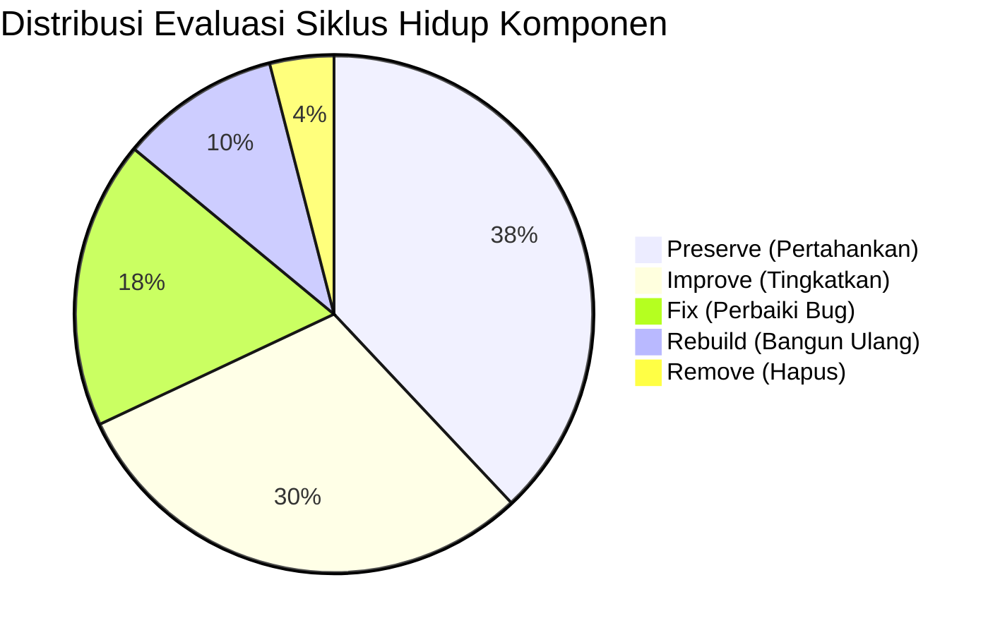

# 03. Comprehensive Gap Analysis & Component Evaluation: Sepakatin

**Project:** Sepakatin  
**Auditor Roles:** Senior Product Manager, Software Architect, QA Engineer, UI/UX Auditor, Technical Business Analyst  
**Audit Scope:** Functional correctness, UI/UX, security, authorization, data integrity, reliability, performance, maintainability, and production readiness.  
**Repository Working Directory:** `e:\Fadli\7 Kegiatan\Lomba\Exploreaition\sepakatin`  

---

## 1. Structured Gap & Issue Log

Setiap isu diidentifikasi dengan ID unik terstruktur, bukti langsung dari basis kode, analisis dampak teknis dan bisnis, rekomendasi tindakan, serta metode verifikasi pengujian.

```
Severity Breakdown:
🔴 Critical (Blocker): 4 Issues
🟠 High (Major): 5 Issues
🟡 Medium (Moderate): 4 Issues
🔵 Low (Minor): 2 Issues
```

---

### GAP-TST-001: Kegagalan Masif Unit Test Akibat Assertion Drift & Typo Properti
- **Kategori:** Maintainability & Functional Correctness
- **Tingkat Keparahan:** 🔴 **Critical**
- **Bukti Kode:**
  - [tests/01-contract-creation.test.ts:89](file:///e:/Fadli/7%20Kegiatan/Lomba/Exploreaition/sepakatin/tests/01-contract-creation.test.ts#L89): Test mengharapkan teks error `"Uang muka (DP)"`, sedangkan [lib/agreement-logic.ts:100](file:///e:/Fadli/7%20Kegiatan/Lomba/Exploreaition/sepakatin/lib/agreement-logic.ts#L100) melempar `"Persentase DP tidak valid."`.
  - [tests/03-version-revision-flow.test.ts:73](file:///e:/Fadli/7%20Kegiatan/Lomba/Exploreaition/sepakatin/tests/03-version-revision-flow.test.ts#L73): Test mengharapkan status `PENDING_CLIENT`, sedangkan implementasi logika mengubah ke `PENDING_APPROVAL`.
  - [tests/05-consensus-autolock.test.ts:74](file:///e:/Fadli/7%20Kegiatan/Lomba/Exploreaition/sepakatin/tests/05-consensus-autolock.test.ts#L74): Mengakses properti `err.statusCode === 409`, padahal kelas `AgreementError` menggunakan properti `status`.
  - [tests/06-document-hash-verification.test.ts:54](file:///e:/Fadli/7%20Kegiatan/Lomba/Exploreaition/sepakatin/tests/06-document-hash-verification.test.ts#L54): Menghitung hash dari objek mentah tanpa proses sanitasi default.
  - [tests/08-health-monitoring.test.ts:9](file:///e:/Fadli/7%20Kegiatan/Lomba/Exploreaition/sepakatin/tests/08-health-monitoring.test.ts#L9): Probe database gagal dan mengembalikan HTTP 503 saat dijalankan tanpa koneksi aktif Supabase.
- **Dampak Teknis & Bisnis:**
  - 5 dari 8 kelompok tes gagal total saat `npm test` dijalankan.
  - Klaim dokumentasi publik pada `README.md` ("100% Passed & Siap Launch") merupakan informasi yang salah dan menyesatkan pemangku kepentingan.
  - Mencegah integrasi pipeline CI/CD otomatis karena proses pengujian akan selalu gagal (exit code 1).
- **Rekomendasi Tindakan:** **FIX**
  - Selaraskan seluruh ekspektasi string error dan enum status di dalam berkas tes.
  - Perbaiki akses properti `err.status` pada kelas `AgreementError`.
  - Berikan mock koneksi atau kondisi fallback pada pengujian health check.
- **Metode Verifikasi:** Jalankan `npm test` dan pastikan seluruh 8 suite lulus 100% (exit code 0) di lingkungan lokal maupun CI.

---

### GAP-DAT-001: Penyimpanan Berkas PDF Berukuran Besar di Kolom JSONB Database & LocalStorage
- **Kategori:** Data Integrity, Performance & Reliability
- **Tingkat Keparahan:** 🔴 **Critical**
- **Bukti Kode:**
  - [lib/agreement-logic.ts:480-498](file:///e:/Fadli/7%20Kegiatan/Lomba/Exploreaition/sepakatin/lib/agreement-logic.ts#L480-L498): Menyimpan berkas PDF Base64 hingga 7.5 MB (`MAX_DOCUMENT_CHARS = 10_000_000`) ke dalam array `agr.stampedDocuments`.
  - [supabase/migrations/001_initial_schema.sql:49](file:///e:/Fadli/7%20Kegiatan/Lomba/Exploreaition/sepakatin/supabase/migrations/001_initial_schema.sql#L49): Seluruh objek agreement termasuk array dokumen bermeterai disimpan di kolom `record jsonb`.
  - [lib/store.ts:81-88](file:///e:/Fadli/7%20Kegiatan/Lomba/Exploreaition/sepakatin/lib/store.ts#L81-L88): Mode lokal menyimpan seluruh array kesepakatan ke `localStorage.setItem(LOCAL_KEY, ...)`.
- **Dampak Teknis & Bisnis:**
  - Pada mode lokal: Mengunggah 1 file PDF (5 MB) akan langsung melebihi kuota penyimpanan browser (5 MB per domain di Safari/Chrome), memicu `DOMException: QuotaExceededError` dan merusak fungsionalitas aplikasi.
  - Pada mode Supabase: Tabel PostgreSQL membengkak drastis (*table bloat*), memperlambat backup, meningkatkan konsumsi kuota bandwidth Supabase, dan dapat memicu batas transmisi payload serverless.
- **Rekomendasi Tindakan:** **REBUILD / REFACTOR**
  - Berkas PDF bermeterai tidak boleh disimpan sebagai string Base64 di dalam database.
  - Manfaatkan **Supabase Storage Bucket** (`documents/{agreement_id}/{copy_type}.pdf`) dengan presigned upload URL.
  - Tabel database hanya mencatat URL publik/privat S3 bucket, ukuran berkas, dan SHA-256 checksum-nya.
- **Metode Verifikasi:** Uji pengunggahan dokumen PDF 5 MB. Pastikan ukuran baris tabel PostgreSQL tetap di bawah 50 KB dan berkas tersimpan aman di objek storage.

---

### GAP-SEC-001: Ketiadaan Masa Kedaluwarsa (No TTL) pada Review Token Klien
- **Kategori:** Security & Authorization
- **Tingkat Keparahan:** 🔴 **Critical**
- **Bukti Kode:**
  - [lib/agreement-logic.ts:80-85](file:///e:/Fadli/7%20Kegiatan/Lomba/Exploreaition/sepakatin/lib/agreement-logic.ts#L80-L85): `newReviewToken()` menghasilkan token acak statis.
  - [supabase/migrations/001_initial_schema.sql:43](file:///e:/Fadli/7%20Kegiatan/Lomba/Exploreaition/sepakatin/supabase/migrations/001_initial_schema.sql#L43): Kolom `review_token text not null unique` tidak memiliki pasangan kolom `token_expires_at` atau mekanisme pencabutan (*revocation*).
  - [app/api/review/[token]/route.ts:22-28](file:///e:/Fadli/7%20Kegiatan/Lomba/Exploreaition/sepakatin/app/api/review/%5Btoken%5D/route.ts#L22-L28): Endpoint terbuka tanpa validasi kedaluwarsa waktu.
- **Dampak Teknis & Bisnis:**
  - Jika tautan WhatsApp bocor atau dibagikan ke pihak ketiga berbulan-bulan setelah proyek dibuat, siapa pun yang memegang tautan dapat membaca isi perjanjian atau mengajukan aksi pada status yang belum terkunci.
  - Tidak ada opsi bagi freelancer untuk membatalkan token lama atau menerbitkan token review baru jika tautan salah kirim.
- **Rekomendasi Tindakan:** **IMPROVE**
  - Tambahkan kolom `review_token_expires_at` (default: 14 hari sejak dikirim).
  - Berikan fitur bagi freelancer untuk melakukan regenerasi tautan review (*Regenerate Review Link*) yang otomatis mematikan token lama.
- **Metode Verifikasi:** Coba akses endpoint `/api/review/[token]` dengan token yang sengaja diset melewati tanggal kedaluwarsa; pastikan server merespons HTTP 410 Gone atau 404 Not Found.

---

### GAP-REL-001: Pendeteksian Supabase Statis Mematikan Aplikasi Saat Jaringan Gagal
- **Kategori:** Reliability & Fault Tolerance
- **Tingkat Keparahan:** 🔴 **Critical**
- **Bukti Kode:**
  - [lib/supabase.ts:7-9](file:///e:/Fadli/7%20Kegiatan/Lomba/Exploreaition/sepakatin/lib/supabase.ts#L7-L9): `isSupabaseConfigured` hanya mengevaluasi keberadaan variabel lingkungan:
    ```typescript
    export const isSupabaseConfigured = Boolean(
      supabaseUrl && supabaseAnonKey && supabaseUrl.startsWith("http")
    );
    ```
  - [lib/store.ts:147](file:///e:/Fadli/7%20Kegiatan/Lomba/Exploreaition/sepakatin/lib/store.ts#L147): Jika `isSupabaseConfigured` bernilai true, UI secara membabi-buta memanggil API `/api/agreements`.
  - [scripts/check-db.mjs:27-32](file:///e:/Fadli/7%20Kegiatan/Lomba/Exploreaition/sepakatin/scripts/check-db.mjs#L27-L32): Ketika proyek Supabase mengalami *pause* atau koneksi jaringan terputus, pemanggilan melempar `TypeError: fetch failed`.
- **Dampak Teknis & Bisnis:**
  - Pengguna menghadapi halaman error abu-abu / crash HTTP 500 alih-alih dialihkan dengan aman ke mode offline atau diberi peringatan koneksi.
  - Gagal memenuhi prinsip "zero-config fallback" yang dijanjikan pada README.
- **Rekomendasi Tindakan:** **FIX / IMPROVE**
  - Implementasikan mekanisme *health probe banner* di UI.
  - Tangani galat jaringan di API handler server dengan pesan status koneksi yang ramah pengguna, bukan pesan galat internal server.
- **Metode Verifikasi:** Putuskan koneksi internet atau gunakan kredensial Supabase non-aktif; pastikan antarmuka menampilkan status peringatan koneksi tanpa melempar runtime exception yang tidak tertangani.

---

### GAP-SEC-002: Rate Limiting In-Memory Tidak Efektif pada Lingkungan Serverless
- **Kategori:** Security & Scalability
- **Tingkat Keparahan:** 🟠 **High**
- **Bukti Kode:**
  - [lib/server/rate-limit.ts:23-42](file:///e:/Fadli/7%20Kegiatan/Lomba/Exploreaition/sepakatin/lib/server/rate-limit.ts#L23-L42): Menggunakan `const buckets = new Map<string, Bucket>()` di memori proses Node.js.
  - Komentar kode di baris 5–8 secara eksplisit mengakui keterbatasan ini:
    ```typescript
    // Disimpan di memori proses. Di lingkungan serverless setiap instance punya
    // hitungannya sendiri dan memori bisa hilang saat instance didaur ulang...
    ```
- **Dampak Teknis & Bisnis:**
  - Pada hosting Vercel/AWS Lambda, setiap eksekusi fungsi dapat dijalankan pada instans serverless yang berbeda (*cold start / horizontal scale*).
  - Penyerang dapat melakukan serangan brute force atau DoS terhadap endpoint `/api/review/[token]` dan `/api/verify/[contractId]` dengan menyebar permintaan lintas instans tanpa terdeteksi oleh Map lokal.
- **Rekomendasi Tindakan:** **IMPROVE**
  - Pindahkan mekanisme rate limiting ke tabel PostgreSQL di Supabase (misal via fungsi atomik atau ekstensi) atau gunakan Redis (Upstash) yang memiliki latensi rendah lintas instans serverless.
- **Metode Verifikasi:** Lakukan 100 permintaan berturut-turut dari IP yang sama ke lingkungan serverless multi-instans; pastikan rate limiter memblokir permintaan setelah kuota tercapai.

---

### GAP-UX-001: Konflik Mental Model antara e-Materai Simulasi vs Upload Dokumen Fisik
- **Kategori:** UI/UX & Compliance
- **Tingkat Keparahan:** 🟠 **High**
- **Bukti Kode:**
  - [app/agreements/[id]/page.tsx:53](file:///e:/Fadli/7%20Kegiatan/Lomba/Exploreaition/sepakatin/app/agreements/%5Bid%5D/page.tsx#L53): Tab navigasi memiliki tab terpisah untuk `"meterai"`.
  - [components/PrintableAgreement.tsx:53-56](file:///e:/Fadli/7%20Kegiatan/Lomba/Exploreaition/sepakatin/components/PrintableAgreement.tsx#L53-L56): Merender stempel simulasi e-Materai grafis.
  - [lib/agreement-logic.ts:474-506](file:///e:/Fadli/7%20Kegiatan/Lomba/Exploreaition/sepakatin/lib/agreement-logic.ts#L474-L506): Aksi `uploadStampedDocument` mewajibkan upload file PDF resmi eksternal.
- **Dampak Teknis & Bisnis:**
  - Pengguna pemula bingung apakah dengan menempelkan meterai di tab aplikasi dokumennya sudah berkekuatan hukum, atau apakah mereka wajib membayar dan membubuhkan meterai di portal Peruri.
  - Risiko hukum: Pengguna mengira simulasi stempel grafis Rp10.000 sudah setara dengan bea meterai resmi menurut UU Bea Meterai No. 10 Tahun 2020.
- **Rekomendasi Tindakan:** **IMPROVE**
  - Rombak alur tab "e-Materai": Posisikan jelas sebagai "Panduan Pembubuhan e-Materai Resmi".
  - Berikan panduan visual 3 langkah: (1) Unduh PDF Sepakatin, (2) Bubuhkan di portal resmi (Pos Fin / Peruri / Privy), (3) Unggah kembali berkas PDF akhir yang sah.
  - Beri label tegas "SIMULASI VISUAL - BUKAN BEA METERAI RESMI" pada gambar stempel digital lokal.
- **Metode Verifikasi:** Lakukan pengujian kegunaan (*usability testing*) pada 5 freelancer untuk mengonfirmasi kejelasan alur pembubuhan meterai.

---

### GAP-FIN-001: Ketiadaan Otomasi Pembayaran & Integrasi Payment Gateway
- **Kategori:** Functional Correctness & Monetization
- **Tingkat Keparahan:** 🟠 **High**
- **Bukti Kode:**
  - [lib/contact.ts:8-16](file:///e:/Fadli/7%20Kegiatan/Lomba/Exploreaition/sepakatin/lib/contact.ts#L8-L16): Tautan CTA paket mengarahkan ke obrolan WhatsApp admin pribadi (`wa.me/6285339333616`).
  - [app/api/admin/route.ts:85-104](file:///e:/Fadli/7%20Kegiatan/Lomba/Exploreaition/sepakatin/app/api/admin/route.ts#L85-L104): Upgrade paket akun dan penambahan kredit wajib dilakukan secara manual oleh administrator via tombol di Admin Panel.
- **Dampak Teknis & Bisnis:**
  - Tingginya friksi pembelian (*drop-off rate*) saat freelancer kehabisan kuota gratis dan ingin membayar Rp19.000 untuk kesepakatan baru.
  - Skalabilitas bisnis terhambat karena proses pemutakhiran kredit memerlukan intervensi manual manusia 24/7.
- **Rekomendasi Tindakan:** **REBUILD / ENHANCE**
  - Integrasikan Payment Gateway Indonesia (Midtrans Snap atau Xendit Invoice) untuk pembayaran instan via QRIS, GoPay, OVO, dan Virtual Account BCA/Mandiri.
  - Gunakan webhook serverless untuk otomatis menambahkan kredit profil (`use_project_credit`) begitu pembayaran terverifikasi lunas.
- **Metode Verifikasi:** Lakukan transaksi simulasi via QRIS Sandbox; pastikan webhook berhasil memutakhirkan nilai `project_credits` pengguna secara otomatis tanpa akses admin.

---

### GAP-NOTIF-001: Ketiadaan Notifikasi Real-time (Ketergantungan Salin Tautan Manual)
- **Kategori:** UI/UX & User Retention
- **Tingkat Keparahan:** 🟠 **High**
- **Bukti Kode:**
  - [app/agreements/[id]/page.tsx:86](file:///e:/Fadli/7%20Kegiatan/Lomba/Exploreaition/sepakatin/app/agreements/%5Bid%5D/page.tsx#L86): Pengiriman tautan hanya mengandalkan `copyReviewLink`.
  - [lib/agreement-logic.ts:644](file:///e:/Fadli/7%20Kegiatan/Lomba/Exploreaition/sepakatin/lib/agreement-logic.ts#L644): Saat klien mengajukan perubahan, sistem hanya mencatat ke array `activityLogs`, tanpa mengirimkan email atau pesan notifikasi apa pun kepada freelancer.
- **Dampak Teknis & Bisnis:**
  - Freelancer tidak mengetahui secara tepat waktu saat klien telah menandatangani atau meminta revisi kesepakatan, kecuali freelancer membuka kembali dasbor secara manual.
  - Memperlambat siklus persetujuan proyek (*cycle time*).
- **Rekomendasi Tindakan:** **IMPROVE**
  - Integrasikan penyedia email transaksional modern (seperti Resend) untuk mengirim notifikasi: "Klien Anda baru saja menyetujui kontrak SPK-2026-XXXXX".
  - Tambahkan integrasi WhatsApp Business API / Fonnte untuk notifikasi instan.
- **Metode Verifikasi:** Buat simulasi permintaan perubahan oleh klien; pastikan email notifikasi terkirim ke alamat email freelancer terdaftar dalam waktu < 10 detik.

---

### GAP-ARCH-001: Skema Dokumen JSONB Tunggal Membatasi Analitik & Pengindeksan Relasional
- **Kategori:** Maintainability & Architecture
- **Tingkat Keparahan:** 🟠 **High**
- **Bukti Kode:**
  - [supabase/migrations/001_initial_schema.sql:49](file:///e:/Fadli/7%20Kegiatan/Lomba/Exploreaition/sepakatin/supabase/migrations/001_initial_schema.sql#L49): Kolom `record jsonb` menyimpan objek besar yang berisi versi, approval, milestons, change requests, dan activity logs.
  - [supabase/migrations/002_performance_indexes.sql:6-17](file:///e:/Fadli/7%20Kegiatan/Lomba/Exploreaition/sepakatin/supabase/migrations/002_performance_indexes.sql#L6-L17): Indeks hanya dipasang pada kolom skalar (`status`, `owner_id`, `created_at`), tidak pada data di dalam JSONB.
- **Dampak Teknis & Bisnis:**
  - Kesulitan melakukan query analitik mendalam di PostgreSQL (misal: "Berapa rata-rata jumlah revisi per freelancer?" atau "Berapa total nilai milestone yang jatuh tempo bulan ini?").
  - Mengharuskan aplikasi membaca seluruh payload JSONB setiap kali mutasi kecil terjadi.
- **Rekomendasi Tindakan:** **IMPROVE**
  - Pertahankan `agreements.record` untuk portabilitas dokumen, namun lakukan ekstraksi kolom ringkasan (*computed columns*) atau tabel pendukung terpisah untuk `milestones` dan `change_requests` jika fitur pelacakan milestone interaktif akan diluncurkan di Phase 2.
- **Metode Verifikasi:** Pastikan query agregasi analitik platform dapat dieksekusi dalam waktu < 100ms tanpa memerlukan *table scan* penuh terhadap kolom JSONB.

---

### GAP-SEC-003: Ketiadaan Log Audit untuk Operasi Administrator
- **Kategori:** Security & Compliance
- **Tingkat Keparahan:** 🟡 **Medium**
- **Bukti Kode:**
  - [app/api/admin/route.ts:85-127](file:///e:/Fadli/7%20Kegiatan/Lomba/Exploreaition/sepakatin/app/api/admin/route.ts#L85-L127): Aksi admin (`updatePlan`, `updateCredits`, `cancel`, `delete`) langsung mengubah basis data tanpa mencatat siapa admin yang melakukan operasi tersebut.
- **Dampak Teknis & Bisnis:**
  - Jika platform dikelola oleh lebih dari 1 admin, tidak ada jejak akuntabilitas (*non-repudiation*) jika terjadi pembatalan kontrak sepihak atau manipulasi kredit pengguna.
- **Rekomendasi Tindakan:** **FIX**
  - Buat tabel `admin_audit_logs` di Supabase untuk mencatat `admin_id`, `action`, `target_user_id`, `target_agreement_id`, dan timestamp.
- **Metode Verifikasi:** Eksekusi perubahan kredit via `/api/admin`; verifikasi bahwa baris baru tercatat di tabel `admin_audit_logs`.

---

### GAP-PDF-001: Rendering Client-Side PDF Menggunakan html2canvas Rentan Distorsi Resolusi
- **Kategori:** UI/UX & Reliability
- **Tingkat Keparahan:** 🟡 **Medium**
- **Bukti Kode:**
  - [components/PrintableAgreement.tsx:103-120](file:///e:/Fadli/7%20Kegiatan/Lomba/Exploreaition/sepakatin/components/PrintableAgreement.tsx#L103-L120): Menggunakan `html2canvas` dengan `scale: 2` untuk merender elemen DOM ke gambar kanvas sebelum dimasukkan ke `jsPDF`.
- **Dampak Teknis & Bisnis:**
  - Teks pada PDF hasil konversi berupa gambar (*rasterized bitmap*), bukan teks vektor asli yang dapat di-seleksi/dicari (*searchable*).
  - Tampilan teks dapat terlihat buram saat dicetak fisik pada printer resolusi tinggi (300+ DPI), dan ukuran berkas PDF membengkak tidak proporsional.
- **Rekomendasi Tindakan:** **IMPROVE**
  - Prioritaskan fitur dialog cetak peramban asli (`window.print()`) yang menghasilkan vektor PDF sempurna dengan stylesheet `@media print`.
  - Untuk ekspor berkas langsung, pertimbangkan server-side PDF generator berbasis Chromium (misalnya Puppeteer atau @react-pdf/renderer) di masa depan.
- **Metode Verifikasi:** Cetak dokumen via dialog cetak; pastikan teks hasil cetak tetap tajam dan dapat di-blok/disalin sebagai teks asli.

---

### GAP-UX-002: Ukuran Berkas Monolitik pada Halaman Detail Kesepakatan
- **Kategori:** Maintainability & Code Quality
- **Tingkat Keparahan:** 🟡 **Medium**
- **Bukti Kode:**
  - [app/agreements/[id]/page.tsx](file:///e:/Fadli/7%20Kegiatan/Lomba/Exploreaition/sepakatin/app/agreements/%5Bid%5D/page.tsx): Berkas terdiri dari **1.888 baris kode** dan ukuran berkas mencapai 91.1 KB.
- **Dampak Teknis & Bisnis:**
  - Sangat sulit dipelihara (*high cognitive load*), rentan memicu regresi saat perbaikan bug, dan memperlambat proses pengembangan tim.
  - Seluruh modal (versi baru, unggah meterai, tanda tangan, konfirmasi batal) ditumpuk dalam satu berkas komponen.
- **Rekomendasi Tindakan:** **REFACTOR**
  - Pecah berkas menjadi sub-komponen modular:
    - `components/agreements/AgreementVersionModal.tsx`
    - `components/agreements/AgreementStampedDocModal.tsx`
    - `components/agreements/AgreementAuditTimeline.tsx`
- **Metode Verifikasi:** Pastikan tidak ada berkas komponen yang melebihi 400 baris kode dan seluruh fungsionalitas tetap berjalan normal.

---

### GAP-VAL-001: Ketiadaan Validasi Batas Maksimal Tanggal Tenggat (Boundary Case)
- **Kategori:** Functional Correctness
- **Tingkat Keparahan:** 🟡 **Medium**
- **Bukti Kode:**
  - [lib/agreement-logic.ts:144-154](file:///e:/Fadli/7%20Kegiatan/Lomba/Exploreaition/sepakatin/lib/agreement-logic.ts#L144-L154): Fungsi sanitasi memvalidasi `deadline >= startDate`, tetapi tidak menetapkan batas atas rentang durasi proyek (misalnya proyek berdurasi 50 tahun ke depan).
- **Dampak Teknis & Bisnis:**
  - Pengguna dapat secara tidak sengaja atau sengaja memasukkan tahun keliru (misal tahun 2099), membuat nomor kontrak dan status validitas aktif selamanya.
- **Rekomendasi Tindakan:** **FIX**
  - Tambahkan batasan durasi wajar: `deadline` maksimal 5 tahun sejak `startDate`.
- **Metode Verifikasi:** Masukkan tenggat tahun 2040 pada pembuatan kesepakatan; pastikan validator menolak input dengan pesan error yang jelas.

---

### GAP-LEG-001: Pernyataan Kekuatan Hukum & Kepatuhan Tanda Tangan Elektronik
- **Kategori:** Legal Compliance & Risk Mitigation
- **Tingkat Keparahan:** 🔵 **Low**
- **Bukti Kode:**
  - [PRD_Sepakatin.md:518-532](file:///e:/Fadli/7%20Kegiatan/Lomba/Exploreaition/sepakatin/PRD_Sepakatin.md#L518-L532): PRD telah memperingatkan agar tidak mengklaim "Tanda Tangan Bersertifikat".
  - [README.md:13](file:///e:/Fadli/7%20Kegiatan/Lomba/Exploreaition/sepakatin/README.md#L13): Di sisi lain, README sempat menggunakan frasa "e-Materai resmi" dan "tanda tangan digital sah".
- **Dampak Teknis & Bisnis:**
  - Potensi kesalahpahaman pengguna mengenai status Tanda Tangan Elektronik (TTE) Tersertifikasi (PSrE Berizin Kominfo seperti PrivyID/Peruri) vs TTE Tidak Tersertifikasi (kanvas visual + hash integritas).
- **Rekomendasi Tindakan:** **PRESERVE & CLARIFY**
  - Pertahankan disclaimer hukum di footer dan halaman verifikasi.
  - Perjelas istilah di UI menjadi "Persetujuan & Tanda Tangan Digital Non-Sertifikasi (Alat Bukti Elektronik Menurut UU ITE)".
- **Metode Verifikasi:** Periksa seluruh salinan teks pemasaran di landing page dan dokumen cetak agar konsisten dengan klausul batasan tanggung jawab hukum.

---

### GAP-ENV-001: Peringatan Variabel Lingkungan Demo Lokal di Produksi
- **Kategori:** Security
- **Tingkat Keparahan:** 🔵 **Low**
- **Bukti Kode:**
  - [lib/auth.ts:105](file:///e:/Fadli/7%20Kegiatan/Lomba/Exploreaition/sepakatin/lib/auth.ts#L105): `NEXT_PUBLIC_LOCAL_DEMO_PASSWORD`.
  - [.env.example:24](file:///e:/Fadli/7%20Kegiatan/Lomba/Exploreaition/sepakatin/.env.example#L24): Didokumentasikan dengan baik bahwa variabel ini wajib dikosongkan di produksi.
- **Dampak Teknis & Bisnis:**
  - Jika pengembang tidak sengaja mengisi nilai ini di hosting produksi (Vercel), kredensial akun demo akan bocor ke klien browser publik.
- **Rekomendasi Tindakan:** **PRESERVE**
  - Desain *fail-closed* saat ini sudah tepat (bila kosong, akun demo dinonaktifkan total). Pastikan dokumentasi deployment tetap mewajibkan nilai ini kosong.
- **Metode Verifikasi:** Periksa bundel JavaScript hasil build produksi; pastikan tidak ada string kata sandi bawaan yang terbundel.

---

## 2. Component Lifecycle Evaluation

Evaluasi strategis terhadap setiap komponen eksisting: menentukan apakah komponen harus **Dipertahankan (Preserve)**, **Diperbaiki (Fix)**, **Ditingkatkan (Improve)**, **Dibangun Ulang (Rebuild)**, atau **Dihapus (Remove)**.



### 2.1 Komponen yang DIPERTAHANKAN (PRESERVE)
Komponen yang sudah memiliki fondasi arsitektur solid, aman, dan bekerja optimal:
1. **`lib/crypto.ts`:** Algoritma pengurutan kanonikal `canonicalJsonStringify` dan pembuatan hash SHA-256 Web Crypto API sudah sangat rapi, deterministik, dan teruji.
2. **`components/Navbar.tsx` & `components/Footer.tsx`:** Navigasi responsif, branding konsisten, dukungan disclaimer hukum terpasang rapi.
3. **`components/QRCodeViewer.tsx`:** Komponen generator QR code dinamis ringan berbasis canvas/data URL.
4. **`components/StatusBadge.tsx`:** Tampilan badge status kesepakatan dengan palet warna dan dot indikator yang rapi.
5. **`components/ModalDialog.tsx`:** Komponen dialog interaktif yang aksesibel (dukungan tombol Esc, penguncian scroll layar).
6. **`app/globals.css` (@media print):** Modul CSS cetak A4 dengan margin 15mm standar formal.

### 2.2 Komponen yang DIPERBAIKI (FIX)
Komponen yang memiliki cacat logika atau bug langsung:
1. **`tests/*.test.ts` (Kelompok Pengujian Unit):** Perbaiki 5 berkas test suite yang rusak agar lulus uji coba otomatis `npm test`.
2. **`lib/agreement-logic.ts` (Validasi Batas):** Tambahkan batas atas rentang tenggat waktu (maks. 5 tahun) dan perbaiki sinkronisasi pesan error dengan suite test.
3. **`app/api/admin/route.ts` (Audit Admin):** Pasang pencatatan riwayat audit saat admin melakukan perubahan paket, kredit, atau moderasi dokumen.

### 2.3 Komponen yang DITINGKATKAN (IMPROVE)
Komponen yang fungsional tetapi membutuhkan optimasi performa atau keamanan:
1. **`lib/server/rate-limit.ts`:** Tingkatkan dari memory-based `Map` menjadi database-backed atau Redis-backed rate limiter agar efektif di serverless hosting.
2. **`lib/agreement-logic.ts` (Review Token Lifecycle):** Tambahkan masa berlaku token (*TTL / token_expires_at*) dan kemampuan menerbitkan ulang link peninjauan klien.
3. **`components/PrintableAgreement.tsx`:** Sempurnakan alur cetak dokumen agar memprioritaskan dialog print asli peramban (`window.print()`) dan tambahkan watermark draft bila dokumen belum berstatus `AGREED`.
4. **`app/agreements/[id]/page.tsx`:** Lakukan refaktorisasi modular dengan memecah berkas 1.888 baris ini menjadi sub-komponen terpisah.

### 2.4 Komponen yang DIBANGUN ULANG (REBUILD)
Komponen atau modul yang memiliki kelemahan arsitektur struktural:
1. **Penyimpanan Berkas PDF Bermeterai (`stampedDocuments`):**
   - **Masalah:** Disimpan dalam Base64 di dalam kolom JSONB basis data dan LocalStorage.
   - **Solusi Rebuild:** Bangun modul integrasi **Supabase Storage** terdedikasi. Berkas diunggah via multipart stream/presigned URL langsung ke object bucket; database hanya menyimpan metadata dan URL unduhan.
2. **Sistem Pembayaran & Monetisasi Paket:**
   - **Masalah:** Manual via chat WhatsApp admin.
   - **Solusi Rebuild:** Bangun modul checkout otomatis dengan Payment Gateway (Midtrans/Xendit) untuk pembelian kredit proyek instan dan langganan Pro.

### 2.5 Komponen yang DIHAPUS (REMOVE)
Komponen yang sudah usang, memicu kebingungan, atau menimbulkan redundansi:
1. **Stempel Grafis e-Materai Lokal (Simulasi Kanvas Murni):** Hapus opsi "tempel stempel grafis internal" yang berpotensi melanggar ketentuan hukum bea meterai jika tidak disertai dokumen PDF resmi Peruri.
2. **Skrip Uji Ad-hoc Lama di `scripts/`:** Bersihkan skrip pengujian manual yang tidak lagi digunakan dan integrasikan seluruh kasus uji ke dalam suite pengujian resmi di `tests/`.
