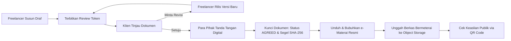

# 04. Product Requirements Document (PRD): Sepakatin 2.0

**Product Name:** Sepakatin  
**Version:** 2.0 (Rebuild & Modernization Specification)  
**Author:** Senior Product Manager & Technical Business Analyst  
**Document Status:** Ready for Stakeholder Review  
**Repository Context:** `e:\Fadli\7 Kegiatan\Lomba\Exploreaition\sepakatin`  

---

## 1. Overview

Sepakatin adalah platform digital berbasis web yang dirancang khusus untuk memfasilitasi pembuatan, peninjauan, persetujuan bersama, penguncian versi (*version locking*), pembubuhan e-Materai, ekspor dokumen, dan verifikasi publik atas surat kesepakatan kerja antara pekerja lepas (freelancer digital) dan pemberi kerja (klien) di Indonesia.

Sepakatin bertindak sebagai **lapisan kepercayaan digital (*digital trust layer*) dan sumber kebenaran tunggal (*single source of truth*)** atas ruang lingkup pekerjaan, jadwal pembayaran, uang muka (DP), batasan revisi, dan hak kekayaan intelektual (HKI). Sepakatin **bukan** kantor hukum, bukan penyedia nasihat hukum formal, dan tidak menggantikan peranan advokat profesional.

---

## 2. Problem

Berdasarkan analisis bukti permasalahan yang direkonstruksi dari alur kode ([PRD_Sepakatin.md:33-47](file:///e:/Fadli/7%20Kegiatan/Lomba/Exploreaition/sepakatin/PRD_Sepakatin.md#L33-L47) & [app/page.tsx:42-47](file:///e:/Fadli/7%20Kegiatan/Lomba/Exploreaition/sepakatin/app/page.tsx#L42-L47)):

1. **Informasi Tersebar (*Fragmented Communication*):** Kesepakatan proyek disepakati secara informal melalui puluhan hingga ratusan pesan WhatsApp, obrolan email, dan catatan suara (*voice note*), menyulitkan penelusuran saat terjadi perbedaan interpretasi.
2. **Pergeseran Lingkup Tanpa Kompensasi (*Scope Creep*):** Klien kerap meminta tambahan fitur atau pekerjaan di luar kesepakatan awal tanpa penyesuaian biaya karena lingkup awal tidak terdokumentasi secara tertutup.
3. **Sengketa Batasan Revisi:** Batasan jumlah dan kriteria revisi tidak disepakati sejak awal, menyebabkan permintaan revisi berulang kali tanpa batas.
4. **Kepastian Pembayaran & Termin:** Jadwal penagihan uang muka (DP) dan pelunasan sering molor karena kriteria serah terima (*acceptance criteria*) tidak terdefinisi jelas.
5. **Ketiadaan Alat Bukti Autentik:** Bukti percakapan chat mudah dihapus, dimanipulasi, dan tidak memiliki penanda integritas kriptografi yang diakui sebagai alat bukti elektronik yang kuat.

---

## 3. Target Users

### 3.1 Primary User: Freelancer Digital Indonesia
- **Peran:** Web/Mobile Developer, UI/UX Designer, Graphic Designer, Video Editor, Copywriter, Social Media Specialist, Konsultan Pemasaran Digital, Agency Kreatif Skala Kecil.
- **Karakteristik Operasional:** Mengelola transaksi kerja langsung dengan klien mandiri, mengandalkan WhatsApp/email sebagai saluran transaksi harian, memerlukan dokumen perjanjian profesional yang cepat dibuat tanpa biaya legal yang mahal.
- **Tujuan Utama:** Mengunci ruang lingkup pekerjaan, memastikan kepastian pembayaran DP dan termin, serta memiliki perlindungan tertulis dari revisi berlebih.

### 3.2 Secondary User: Klien / Pemberi Kerja (*Invited Participant*)
- **Peran:** Pemilik UMKM, Manajemen Startup, Agensi Kreatif, Bisnis Perorangan, Individu Pemberi Kerja.
- **Karakteristik Operasional:** Menerima draf kesepakatan dari freelancer. Tidak ingin dibebani keharusan registrasi akun yang rumit hanya untuk menyetujui dokumen kerja.
- **Tujuan Utama:** Memastikan rincian deliverables, kriteria selesai, dan tenggat waktu sesuai dengan ekspektasi sebelum membayarkan uang muka (DP).

### 3.3 Internal User: Administrator Platform
- **Peran:** Tim Operasional dan Keamanan Sepakatin.
- **Tujuan Utama:** Memantau metrik bisnis, mengelola paket akun dan kredit pengguna, memoderasi dokumen yang melanggar hukum, dan menjaga kepatuhan sistem.

---

## 4. Goals & Scope

### 4.1 Product Goals
- Memangkas waktu penyusunan kesepakatan kerja dari rata-rata jam/hari menjadi kurang dari 5 menit menggunakan formulir terstruktur.
- Meniadakan friksi persetujuan bagi klien dengan antarmuka berbasis tautan instan (*zero-login review*).
- Menjamin integritas isi dokumen dengan segel hash SHA-256 kanonikal anti-manipulasi.
- Menyediakan tata letak dokumen cetak resmi A4 dan format berkas PDF bermeterai yang memenuhi standar kepatuhan dokumen usaha di Indonesia.

### 4.2 In-Scope (MVP & Rebuild Phase)
- Autentikasi Pengguna & Profil Freelancer.
- Smart Agreement Builder Multi-Pasal dengan validasi input ketat.
- Lifecycle State Machine: `DRAFT` → `PENDING_CLIENT` → `CHANGES_REQUESTED` → `PENDING_APPROVAL` → `AGREED` → `ACTIVE` → `COMPLETED` / `CANCELLED`.
- Tautan Review Klien berbasis Token Unik.
- Kanvas Tanda Tangan Digital Vektor untuk kedua belah pihak.
- Perekaman Jejak Forensik Audit UU ITE (IP Address, User Agent, Hash Dokumen, Timestamp ISO).
- Sistem Versioning & Manajemen Perubahan (*Change Request*).
- Penyimpanan dan Validasi Berkas PDF Bermeterai Resmi (Peruri).
- Ekspor Dokumen Cetak A4 dan PDF.
- Halaman Publik Cek Keaslian Dokumen via QR Code (`/verify/[contract_id]`).
- Panel Admin untuk manajemen paket akun dan moderasi dokumen.
- Pembatasan Kuota Paket Akun (Gratis, Per-Proyek, Pro).

### 4.3 Out-of-Scope (Fase Selanjutnya)
- Analisis kontrak menggunakan kecerdasan buatan (AI Contract Review).
- Rekening bersama pihak ketiga (Escrow Service).
- Marketplace pencarian freelancer atau lowongan kerja klien.
- Mediasi perselisihan hukum atau kantor bantuan advokat.
- Aplikasi mobile native (iOS / Android) — fokus penuh pada web responsif.
- Tanda Tangan Elektronik Tersertifikasi PSrE (Privy/Vida/Peruri API) langsung di kanvas browser.

---

## 5. Proposed Solution

Sepakatin menghadirkan siklus kerja terpadu:
**`CREATE → REVIEW → NEGOTIATE → SIGN & AGREE → LOCK → STAMP (e-Materai) → EXPORT → VERIFY`**

Solusi memisahkan secara tegas antara data bisnis kesepakatan (disimpan dalam format JSON kanonikal di PostgreSQL) dengan aset berkas biner PDF (disimpan di Supabase Storage Bucket).

---

## 6. Functional & Non-Functional Requirements

### 6.1 Authentication & Profile Management

#### REQ-001: Autentikasi Freelancer Dual-Mode
- **Prioritas:** P0 (Must Have)
- **Tipe:** Functional / Security
- **Sumber Bukti:** [lib/auth.ts:267-339](file:///e:/Fadli/7%20Kegiatan/Lomba/Exploreaition/sepakatin/lib/auth.ts#L267-L339)
- **Kriteria Penerimaan (Acceptance Criteria):**
  1. *Positive:* Pengguna dapat mendaftar dan masuk menggunakan alamat email valid dan kata sandi minimal 6 karakter.
  2. *Negative:* Sistem wajib menolak pendaftaran dengan format email salah atau kata sandi < 6 karakter dengan pesan galat ramah pengguna.
  3. *Boundary:* Sistem menolak pendaftaran jika alamat email sudah terdaftar sebelumnya.
  4. *Failure Case:* Bila koneksi jaringan ke Supabase gagal, aplikasi tidak boleh melempar unhandled error, melainkan menampilkan peringatan status koneksi.

---

### 6.2 Agreement Drafting & Validation

#### REQ-002: Smart Agreement Builder Form
- **Prioritas:** P0 (Must Have)
- **Tipe:** Functional
- **Sumber Bukti:** [app/agreements/new/page.tsx](file:///e:/Fadli/7%20Kegiatan/Lomba/Exploreaition/sepakatin/app/agreements/new/page.tsx) & [lib/agreement-logic.ts:88-211](file:///e:/Fadli/7%20Kegiatan/Lomba/Exploreaition/sepakatin/lib/agreement-logic.ts#L88-L211)
- **Kriteria Penerimaan:**
  1. *Positive:* Freelancer dapat mengisi: Nama Proyek, Identitas Freelancer, Identitas Klien, Deskripsi Pekerjaan, Daftar Deliverables, Daftar Exclusions, Total Biaya, Persentase DP (0–100%), Jatah Revisi, Tanggal Mulai, dan Tanggal Selesai.
  2. *Negative:* Sistem wajib menolak jika daftar deliverables kosong (`deliverables.length === 0`).
  3. *Boundary:* Sistem wajib menolak jika `validUntil < validFrom` atau `deadline < startDate`.
  4. *Boundary:* Sistem wajib menolak jika `dpPercent > 100` atau `dpPercent < 0`.
  5. *Boundary:* Sistem wajib menolak jika durasi proyek melebihi 5 tahun sejak tanggal mulai.
  6. *Permission:* Hanya pengguna terautentikasi yang dapat membuat kesepakatan.

#### REQ-003: Penegakan Batas Kuota Paket Akun (Tier Enforcer)
- **Prioritas:** P0 (Must Have)
- **Tipe:** Functional / Business Rule
- **Sumber Bukti:** [lib/plans.ts:21-49](file:///e:/Fadli/7%20Kegiatan/Lomba/Exploreaition/sepakatin/lib/plans.ts#L21-L49) & [supabase/migrations/001_initial_schema.sql:88-116](file:///e:/Fadli/7%20Kegiatan/Lomba/Exploreaition/sepakatin/supabase/migrations/001_initial_schema.sql#L88-L116)
- **Kriteria Penerimaan:**
  1. *Positive:* Pengguna paket **Gratis** diizinkan memiliki maksimal 2 kesepakatan aktif bersamaan.
  2. *Negative:* Jika kuota 2 kesepakatan aktif tercapai, tombol pembuatan kesepakatan dinonaktifkan kecuali pengguna memakai kredit proyek atau upgrade ke Pro.
  3. *Permission:* Trigger database PostgreSQL `enforce_free_agreement_limit` wajib membatalkan insert secara atomik jika manipulasi dilakukan di luar UI.

---

### 6.3 Client Review & Negotiation Flow

#### REQ-004: Frictionless Token Review Access
- **Prioritas:** P0 (Must Have)
- **Tipe:** Functional / Security
- **Sumber Bukti:** [app/api/review/[token]/route.ts](file:///e:/Fadli/7%20Kegiatan/Lomba/Exploreaition/sepakatin/app/api/review/%5Btoken%5D/route.ts)
- **Kriteria Penerimaan:**
  1. *Positive:* Klien dapat membuka rute `/review/[token]` dan membaca isi perjanjian secara penuh tanpa login akun.
  2. *Security:* Akses dibatasi laju permintaannya (*rate limited*) maksimal 60 permintaan per menit per alamat IP.
  3. *Negative/Failure:* Tautan dengan token yang salah atau tidak terdaftar harus merespons HTTP 404 "Link tidak berlaku".
  4. *Time-To-Live (TTL):* Tautan review yang telah melewati masa berlaku 14 hari wajib ditolak dengan HTTP 410 Gone / 404 Not Found.

#### REQ-005: Mekanisme Permintaan Perubahan (Change Request)
- **Prioritas:** P0 (Must Have)
- **Tipe:** Functional
- **Sumber Bukti:** [lib/agreement-logic.ts:613-646](file:///e:/Fadli/7%20Kegiatan/Lomba/Exploreaition/sepakatin/lib/agreement-logic.ts#L613-L646)
- **Kriteria Penerimaan:**
  1. *Positive:* Klien dapat mengajukan permintaan perubahan dengan memasukkan Judul dan Penjelasan.
  2. *State:* Status kesepakatan otomatis berubah menjadi `CHANGES_REQUESTED`.
  3. *Boundary:* Sistem membatasi maksimal 3 permintaan perubahan terbuka (*open requests*) yang belum ditindaklanjuti.
  4. *Negative:* Klien tidak dapat meminta perubahan pada dokumen yang sudah berstatus `AGREED`, `COMPLETED`, atau `CANCELLED` (HTTP 409 Conflict).

---

### 6.4 Versioning, Signatures & Consensus Locking

#### REQ-006: Version Bumping & Immutability Lock
- **Prioritas:** P0 (Must Have)
- **Tipe:** Functional / Data Integrity
- **Sumber Bukti:** [lib/agreement-logic.ts:419-473](file:///e:/Fadli/7%20Kegiatan/Lomba/Exploreaition/sepakatin/lib/agreement-logic.ts#L419-L473)
- **Kriteria Penerimaan:**
  1. *In-place Draft:* Pengeditan kesepakatan berstatus `DRAFT` memperbarui versi 1 secara in-place tanpa menaikkan nomor versi.
  2. *Version Bump:* Pengeditan kesepakatan setelah dikirim ke klien menaikkan nomor versi (`v2`, `v3`) dan membatalkan seluruh tanda tangan versi sebelumnya.
  3. *Auto-Lock:* Ketika pihak Freelancer DAN pihak Klien sama-sama telah menyetujui versi yang aktif, status dokumen otomatis berubah menjadi `AGREED`.
  4. *Immutability:* Dokumen berstatus `AGREED` tidak dapat diubah isinya secara sepihak. Setiap modifikasi ditolak oleh server (HTTP 409).

#### REQ-007: Kanvas Tanda Tangan Digital & Jejak Forensik Audit
- **Prioritas:** P0 (Must Have)
- **Tipe:** Functional / Compliance
- **Sumber Bukti:** [components/SignaturePad.tsx](file:///e:/Fadli/7%20Kegiatan/Lomba/Exploreaition/sepakatin/components/SignaturePad.tsx) & [lib/agreement-logic.ts:341-395](file:///e:/Fadli/7%20Kegiatan/Lomba/Exploreaition/sepakatin/lib/agreement-logic.ts#L341-L395)
- **Kriteria Penerimaan:**
  1. *Positive:* Pengguna dapat menggambar tanda tangan di kanvas interaktif dan menyimpannya.
  2. *Forensik:* Server wajib merekam alamat IP asli penandatangan dari header `x-forwarded-for` dan string `User-Agent`.
  3. *Binding:* Tanda tangan terikat secara kriptografis pada nomor versi spesifik dan hash dokumen saat itu.

---

### 6.5 Cryptographic Tamper-Proofing & Public Verification

#### REQ-008: Canonical JSON SHA-256 Document Seal
- **Prioritas:** P0 (Must Have)
- **Tipe:** Security / Data Integrity
- **Sumber Bukti:** [lib/crypto.ts:8-59](file:///e:/Fadli/7%20Kegiatan/Lomba/Exploreaition/sepakatin/lib/crypto.ts#L8-L59)
- **Kriteria Penerimaan:**
  1. *Deterministik:* Pengurutan kunci kanonikal rekursif memastikan objek dengan konten identik menghasilkan string hash yang persis sama.
  2. *Avalanche Effect:* Perubahan 1 karakter pada field mana pun (misal perubahan total harga Rp1) menghasilkan hash SHA-256 yang berubah total.

#### REQ-009: Halaman Verifikasi Publik & Kepatuhan UU PDP
- **Prioritas:** P0 (Must Have)
- **Tipe:** Functional / Privacy Compliance
- **Sumber Bukti:** [app/verify/[contract_id]/page.tsx](file:///e:/Fadli/7%20Kegiatan/Lomba/Exploreaition/sepakatin/app/verify/%5Bcontract_id%5D/page.tsx)
- **Kriteria Penerimaan:**
  1. *Positive:* Publik dapat membuka `/verify/[contract_id]` dan melihat ringkasan: Nama Proyek, Status Persetujuan, Tanggal Persetujuan Para Pihak, dan Status Integritas Hash (`MATCHED` atau `MISMATCH`).
  2. *UU PDP Compliance:* Endpoint publik dilarang keras mengekspos `reviewToken`, `ownerId`, nomor rekening bank, atau isi rincian klausul privat ke pengguna anonim.
  3. *Rate Limiting:* Endpoint verifikasi dibatasi maksimal 30 permintaan per menit per IP untuk mencegah penyisiran nomor dokumen secara massal.

---

### 6.6 Document Storage & e-Materai Handling

#### REQ-010: Pengunggahan PDF Resmi Bermeterai ke Object Storage
- **Prioritas:** P1 (Should Have)
- **Tipe:** Functional / Architecture
- **Sumber Bukti:** [lib/agreement-logic.ts:474-506](file:///e:/Fadli/7%20Kegiatan/Lomba/Exploreaition/sepakatin/lib/agreement-logic.ts#L474-L506) & [lib/server/repo.ts:151-176](file:///e:/Fadli/7%20Kegiatan/Lomba/Exploreaition/sepakatin/lib/server/repo.ts#L151-L176)
- **Kriteria Penerimaan:**
  1. *Magic Bytes Check:* Server wajib menolak berkas yang tidak diawali oleh binary header `%PDF-` (`JVBERi0`).
  2. *Size Limit:* Berkas PDF dibatasi maksimal 10 MB per salinan.
  3. *Object Storage:* Berkas PDF wajib disimpan di Supabase Storage Bucket privat, bukan sebagai string Base64 di dalam kolom JSONB database.

---

### 6.7 Platform Administration & Security

#### REQ-011: Server-Side Admin Whitelist & Audit Logging
- **Prioritas:** P0 (Must Have)
- **Tipe:** Security
- **Sumber Bukti:** [lib/server/repo.ts:85-98](file:///e:/Fadli/7%20Kegiatan/Lomba/Exploreaition/sepakatin/lib/server/repo.ts#L85-L98) & [app/api/admin/route.ts:8-16](file:///e:/Fadli/7%20Kegiatan/Lomba/Exploreaition/sepakatin/app/api/admin/route.ts#L8-L16)
- **Kriteria Penerimaan:**
  1. *Fail-Closed:* Bila variabel lingkungan `ADMIN_EMAILS` tidak diatur, akses admin ditolak secara mutlak untuk seluruh pengguna.
  2. *Server Verification:* Status admin selalu diperiksa ulang di server Next.js pada setiap permintaan API administratif.
  3. *Audit Log:* Setiap aksi modifikasi paket akun pengguna atau moderasi dokumen wajib mencatat log audit ke tabel `admin_audit_logs`.

---

## 7. Success Metrics (Facts vs Assumptions)

### 7.1 Definisi Fakta & Asumsi Metrik
*Sesuai panduan discovery, metrik operasional tidak boleh dikarang bebas. Data historis riil ditandai sebagai FAKTA, sedangkan target pertumbuhan ditandai sebagai ASUMSI/TBD.*

| Metrik Produk | Tipe Data | Nilai Saat Ini | Status / Target |
| :--- | :--- | :--- | :--- |
| **North Star Metric** | Konseptual | Jumlah Kesepakatan yang Berhasil Disetujui Kedua Pihak (`Status: AGREED`) | TBD (Menunggu Peluncuran Produksi) |
| **Akurasi Integritas Hash** | Fakta Kode | 100% Deterministik Kanonikal SHA-256 | Lulus Uji Kriptografi |
| **Rasio Keberhasilan Unit Test** | Fakta Audit | 3 / 8 Kelompok Tes Lulus (37.5%) | **Target: 8 / 8 Lulus (100%)** |
| **Durasi Siklus Pembuatan Draf** | Asumsi PRD | Target < 5 Menit dari Buka Formulir hingga Terbit Link | TBD (Validasi Pengujian Pengguna) |
| **Tingkat Retensi Pengguna** | Asumsi Bisnis | Freelancer membuat kesepakatan berulang pada proyek ke-2 | TBD (Pasca Peluncuran) |
| **Total Pengguna Aktif & GMV** | Metrik Riil | 0 Pengguna Produksi Aktif (Mode Database Baru) | TBD |

---

## 8. Risks & Dependencies

### 8.1 Technical Dependencies
1. **Supabase Cloud Service:** Ketergantungan kritis pada ketersediaan layanan Supabase Auth, PostgreSQL Database, dan Object Storage.
2. **Web Crypto API & Hosting Environment:** Ketergantungan pada dukungan HTTPS browser dan modul kriptografi Node.js server.
3. **html2canvas / jsPDF Engine:** Ketergantungan pustaka sisi peramban untuk konversi DOM ke PDF (memerlukan penanganan kompatibilitas font Poppins).

### 8.2 Product & Business Risks
1. **Risiko Hukum Pemahaman e-Materai:** Klien atau freelancer dapat salah mengartikan simulasi stempel grafis internal sebagai pelunasan bea meterai resmi pemerintah.
   - *Mitigasi:* Edukasi tegas dan penempatan label disclaimer di seluruh dokumen.
2. **Risiko Kebocoran Review Token:** Tautan review yang tidak memiliki batas waktu dapat diakses publik jika pesan chat bocor.
   - *Mitigasi:* Penerapan TTL 14 hari dan opsi regenerasi token.
3. **Risiko Table Bloat Database:** Penyimpanan Base64 PDF dapat membuat tabel database PostgreSQL cepat penuh.
   - *Mitigasi:* Migrasi wajib ke Supabase Storage Buckets.

---

## 9. Stakeholder Decisions & Resolved Questions

Seluruh pertanyaan strategis telah diputuskan dan disetujui oleh Pemilik Produk pada 9 Oktober 2026:
1. **Sistem Pembayaran Paket:** Menggunakan **Opsi B (Otomatisasi via Payment Gateway)** dengan Midtrans Snap (QRIS & Virtual Account tanpa biaya langganan bulanan).
2. **Kepatuhan e-Materai:** Menggunakan **Opsi A (Hapus Simulasi Grafis Lokal)** demi kepatuhan penuh terhadap UU Bea Meterai; fokuskan antarmuka pada panduan pembubuhan resmi di portal Peruri/Pos Fin dan pengunggahan berkas PDF sah.
3. **Masa Berlaku Review Token:** Ditetapkan **14 Hari TTL** dengan penyediaan fitur regenerasi token di dasbor freelancer.
4. **Penyimpanan Berkas PDF:** Ditetapkan **Wajib Migrasi ke Supabase Storage Bucket** privat untuk mengeliminasi Base64 dari database.

---

## 10. Supporting Documents

Dokumen discovery pendukung dalam repositori:
1. [01-codebase-audit.md](file:///e:/Fadli/7%20Kegiatan/Lomba/Exploreaition/sepakatin/docs/product-discovery/01-codebase-audit.md) — Hasil audit menyeluruh kode sumber, arsitektur, dan eksekusi pengujian.
2. [02-feature-inventory.md](file:///e:/Fadli/7%20Kegiatan/Lomba/Exploreaition/sepakatin/docs/product-discovery/02-feature-inventory.md) — Inventarisasi fitur dan penelusuran alur perjalanan pengguna riil.
3. [03-gap-analysis.md](file:///e:/Fadli/7%20Kegiatan/Lomba/Exploreaition/sepakatin/docs/product-discovery/03-gap-analysis.md) — Analisis kesenjangan mendalam dan evaluasi siklus hidup komponen.
4. [05-rebuild-roadmap.md](file:///e:/Fadli/7%20Kegiatan/Lomba/Exploreaition/sepakatin/docs/product-discovery/05-rebuild-roadmap.md) — Rencana peta jalan pembangunan ulang dan modernisasi.
5. [06-open-questions.md](file:///e:/Fadli/7%20Kegiatan/Lomba/Exploreaition/sepakatin/docs/product-discovery/06-open-questions.md) — Kuesioner keputusan teknis dan bisnis untuk pemilik produk.

---

## 11. Custom Sections

### 11.1 Kepatuhan Regulasi & Hukum Indonesia (Indonesian Legal Framework)
- **UU Informasi dan Transaksi Elektronik (UU ITE No. 11/2008 & No. 1/2024):** Persetujuan digital dan tanda tangan kanvas pada Sepakatin memenuhi kualifikasi sebagai *Tanda Tangan Elektronik Tidak Tersertifikasi* yang sah sebagai alat bukti elektronik di pengadilan selama memenuhi syarat identitas para pihak, persetujuan sadar, dan keutuhan dokumen (dijamin oleh SHA-256 seal).
- **UU Pelindungan Data Pribadi (UU PDP No. 27/2022):** Halaman verifikasi publik (`/verify`) dirancang dengan prinsip *data minimization* dan *privacy by design*, di mana data pribadi sensitif (nomor KTP, rekening bank, email privat) tidak dipublikasikan ke publik.
- **UU Bea Meterai (UU No. 10/2020):** Dokumen kesepakatan kerja di atas nilai nominal tertentu memerlukan pelunasan bea meterai agar dapat dijadikan alat bukti perdata di pengadilan. Sepakatin memfasilitasi pengunggahan berkas resmi yang telah dibubuhi e-Materai Peruri/Pos Fin.

### 11.2 Strategi Migrasi Data (Data Migration Strategy)
- Untuk menjaga kompatibilitas mundur (*backward compatibility*):
  1. Dokumen yang telah ada di tabel `agreements` tetap dapat dibaca dengan struktur kolom `record jsonb`.
  2. Skrip migrasi bertahap akan mengekstraksi string Base64 dari `record.stampedDocuments` dan mengunggahnya ke bucket Supabase Storage, lalu mengganti nilai Base64 tersebut dengan URL penyimpanan yang hemat ruang.

### 11.3 Arsitektur Nol Biaya Operasional (Zero-Cost Infrastructure) & Domain Kustom
- **Infrastruktur Bebas Biaya Tetap (Rp0 Biaya Bulanan):**
  - **Supabase Cloud (Free Tier):** 500 MB database PostgreSQL, 1 GB Storage, 50.000 MAU Auth.
  - **Vercel (Hobby Tier):** Hosting serverless gratis dengan sertifikat SSL otomatis.
  - **Payment Gateway (Midtrans Snap Pay-As-You-Go):** Tanpa biaya langganan bulanan (*zero setup/maintenance fee*), potongan hanya dikenakan per transaksi sukses (QRIS ~0.7%).
  - **Email Transaksional (Resend Free Tier):** 3.000 email/bulan gratis.
- **Domain Kustom Permanen (.my.id Jagoan Hosting):**
  - Menggunakan domain kustom gratis `.my.id` (misal `https://[nama-domain].my.id`).
  - QR Code pada dokumen cetak dikunci permanen ke domain ini via `NEXT_PUBLIC_APP_URL`.
