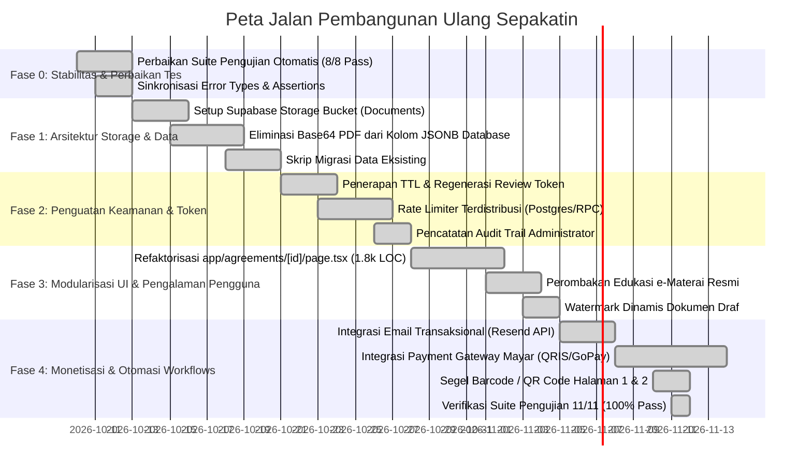
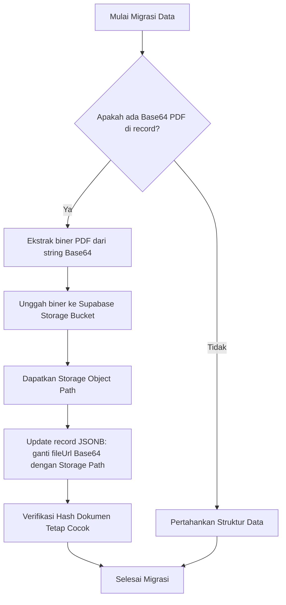

# 05. Rebuild & Modernization Roadmap: Sepakatin

**Project:** Sepakatin  
**Auditor Roles:** Senior Product Manager, Software Architect, QA Engineer, UI/UX Auditor, Technical Business Analyst  
**Document Purpose:** Strategic, phased execution plan for stabilizing, refactoring, and upgrading Sepakatin to production grade.  
**Repository Working Directory:** `e:\Fadli\7 Kegiatan\Lomba\Exploreaition\sepakatin`  

---

## 1. Architectural Strategy: Preserving the Foundation

Berdasarkan audit menyeluruh, **pergantian tumpukan teknologi secara menyeluruh (*total tech-stack rewrite*) TIDAK diperlukan dan tidak disarankan**.

Pondasi teknologi saat ini:
- **Next.js 14 (App Router)**
- **TypeScript 5 (Strict Mode)**
- **Supabase (PostgreSQL + RLS + Auth)**
- **Tailwind CSS 3.4**
- **Web Crypto API (SHA-256 Canonical JSON Hashing)**

Pondasi ini sudah modern, performan, memiliki ekosistem yang matang, dan sangat cocok untuk aplikasi *document-lifecycle management*. Fokus dari pembangunan ulang (*rebuild*) ini adalah **penyembuhan utang teknis (*technical debt remediation*)**, pemisahan aset biner PDF dari database, perbaikan unit test, penguatan keamanan token, dan modularisasi kode.

---

## 2. Phased Execution Roadmap

---

### Fase 0: Baseline Stability & Test Suite Remediation (Prioritas: P0) — [STATUS: SELESAI ✅]
**Tujuan:** Mengembalikan status kesehatan pengujian otomatis dari 3/8 menjadi 8/8 (100% Passed) dan mengamankan baseline regresi sebelum modifikasi fitur.

1. **Sinkronisasi Kasus Uji `tests/01-contract-creation.test.ts`:** (Selesai ✅)
   - Perbaiki string ekspektasi error persentase DP menjadi `"Persentase DP tidak valid."`.
2. **Koreksi Transisi Status `tests/03-version-revision-flow.test.ts`:** (Selesai ✅)
   - Selaraskan ekspektasi status versi baru dari `PENDING_CLIENT` menjadi `PENDING_APPROVAL` (karena rilis versi baru memerlukan persetujuan ulang).
3. **Koreksi Properti Galat `tests/05-consensus-autolock.test.ts`:** (Selesai ✅)
   - Ganti pengecekan `err.statusCode` menjadi `err.status` agar sesuai dengan kelas `AgreementError`.
4. **Penyelarasan Hash Kanonikal `tests/06-document-hash-verification.test.ts`:** (Selesai ✅)
   - Gunakan objek yang telah disanitasi (`sanitizeContent`) saat menghitung baseline hash pembanding.
5. **Mocking Koneksi Database `tests/08-health-monitoring.test.ts`:** (Selesai ✅)
   - Berikan mock probe Supabase agar pengujian unit dapat berjalan terisolasi tanpa koneksi internet langsung.

---

### Fase 1: Storage Architecture & Data Migration (Prioritas: P0) — [STATUS: SELESAI ✅]
**Tujuan:** Menghentikan penyimpanan string Base64 PDF di kolom `agreements.record` JSONB dan `localStorage` peramban.

1. **Pembuatan Bucket Penyimpanan Objek (`supabase/migrations/003_storage_bucket.sql`):** (Selesai ✅)
   - Buat bucket privat di Supabase Storage: `agreement-documents` (10 MB file limit, application/pdf only).
   - Pasang RLS policy pada storage: hanya service role dan pemilik kesepakatan yang dapat mengunggah dan membaca berkas.
2. **Refaktorisasi Antarmuka `StampedDocumentRecord` & Service Layer (`lib/server/storage.ts`):** (Selesai ✅)
   - Ubah properti `StampedDocumentRecord` untuk mendukung `storagePath` (mis. `agreements/agr_123/freelancer_copy.pdf`), mengeliminasi Base64 mentah dari Postgres JSONB.
   - Tambahkan fungsi penerbitan *Signed Download URL* dengan masa berlaku 15 menit (900 detik).
   - Buat endpoint unggah langsung multipart `POST /api/agreements/[id]/document` dan unduhan terproteksi `GET /api/agreements/[id]/document` serta `GET /api/review/[token]/document`.
   - Implementasikan IndexedDB (`lib/local-storage-db.ts`) untuk demo browser lokal agar bebas dari `QuotaExceededError`.
3. **Skrip Migrasi Kompatibilitas Mundur (*Backward Compatibility*):** (Selesai ✅)
   - Dibuat skrip migrasi `scripts/migrate-base64-to-storage.ts` untuk memindai baris database yang masih memuat Base64, mengekstrak filenya ke bucket, dan memutakhirkan kolom referensi tanpa merusak data historis pengguna.

---

### Fase 2: Security & Token Hardening (Prioritas: P1) — [STATUS: SELESAI ✅]
**Tujuan:** Mengamankan celah otorisasi tautan review klien dan menjamin ketahanan terhadap penyalahgunaan di lingkungan cloud serverless.

1. **Review Token Lifecycle & Expiration:** (Selesai ✅)
   - Kolom `review_token_expires_at timestamptz` ditambahkan pada skema database Supabase (`004_security_and_audit.sql`) dengan TTL default 14 hari.
   - Penolakan HTTP 410 `TOKEN_EXPIRED` pada `applyClientAction` dan repo jika tautan kedaluwarsa sebelum disetujui. Dokumen yang sudah sah (`AGREED`, `ACTIVE`, `COMPLETED`) tetap dapat diakses permanen.
   - Tombol "Terbitkan Ulang Tautan" (*Regenerate Link*) diimplementasikan di dashboard freelancer untuk mereset token & TTL 14 hari dalam satu klik.
   - Tampilan khusus ramah pengguna pada halaman `/review/[token]` jika tautan kedaluwarsa.
2. **Rate Limiting Terdistribusi:** (Selesai ✅)
   - Tabel atomik `public.rate_limits` dan RPC function `check_rate_limit(p_key, p_limit, p_window_seconds)` di PostgreSQL Supabase dibuat untuk mencegah lonjakan brute-force lintas instans Vercel tanpa biaya Redis pihak ketiga.
   - Digunakan pada endpoint publik sensitif `/api/review/[token]` dengan fallback in-memory yang aman.
3. **Pencatatan Audit Trail Administrator:** (Selesai ✅)
   - Tabel `public.admin_audit_logs` dan helper `logAdminAction` merekam setiap tindakan sensitif admin (pembaruan paket, kuota kredit, pembatalan, penghapusan kontrak, IP address, dan timestamp).
   - Tab "Jejak Audit" interaktif ditambahkan di halaman `/admin` dengan detail visual JSON modal.

---

### Fase 3: UI Modularization & User Experience Polish (Prioritas: P1) — [STATUS: SELESAI ✅]
**Tujuan:** Mempermudah pemeliharaan kode (*maintainability*), mengeliminasi kebingungan pengguna mengenai e-Materai, dan memberikan validitas visual dokumen draf.

1. **Modularisasi Halaman Detail Kesepakatan (`app/agreements/[id]/page.tsx`):** (Selesai ✅)
   - Komponen monolitik 1.941 baris berhasil dipecah menjadi 6 modul terpisah di `components/agreements/`, merampingkan file utama menjadi ~625 baris:
     - `components/agreements/MilestoneStepper.tsx`: Pita progres alur 4 tahap dokumen + jalan pintas tab.
     - `components/agreements/SignatureTab.tsx`: Penanganan tanda tangan digital pihak freelancer & klien, audit persetujuan forensik IP, dan integrasi SignaturePad.
     - `components/agreements/OfficialEmateraiGuideTab.tsx`: Panduan 3 langkah pembubuhan e-Meterai resmi Peruri & manajemen berkas sah.
     - `components/agreements/ChangeRequestsTab.tsx`: Pelacak kuota revisi gratis vs addendum berbayar serta riwayat permintaan revisi klien.
     - `components/agreements/ActivityTimelineTab.tsx`: Jejak kronologis audit seluruh peristiwa kesepakatan dan daftar versi dokumen.
     - `components/agreements/VersionHistoryModal.tsx`: Dialog form penerbitan versi baru dengan validasi kuota paket Gratis.
2. **Penyempurnaan Alur e-Materai Resmi:** (Selesai ✅)
   - Diganti tab simulasi meterai menjadi modul panduan interaktif 3 langkah:
     - Langkah 1: "Unduh 2 Salinan Berkas Resmi (PDF Siap Meterai)" (Salinan Freelancer & Salinan Klien).
     - Langkah 2: "Beli & Bubuhkan 2 e-Meterai di Distributor Resmi Peruri" (Tautan langsung eksternal ke Pos Fin & e-meterai.co.id).
     - Langkah 3: "Upload 2 Dokumen Final yang Sudah Bermeterai Resmi" (Validasi Magic Bytes %PDF- dan integrasi download URL).
   - Edukasi hukum transparan: Menegaskan UU No. 10 Tahun 2020 Pasal 7 (bebas bea ≤ Rp5 Juta) dan PP No. 86 Tahun 2021 (tidak menggunakan cap meterai simulasi/palsu demi integritas hukum).
3. **Watermark Dinamis Dokumen Draf:** (Selesai ✅)
   - Ditambahkan tanda air visual diagonal semi-transparan `"DRAF KESEPAKATAN — BELUM SAH"` pada halaman 1 dan halaman 2 dokumen cetak & ekspor PDF (`components/PrintableAgreement.tsx` dan `app/agreements/[id]/print/page.tsx`) selama status belum mencapai `AGREED`.
   - Ditambahkan watermark `"KESEPAKATAN DIBATALKAN"` bila dokumen dibatalkan.
   - Dokumen otomatis bersih dari watermark setelah tercapai konsensus persetujuan kedua belah pihak (`AGREED`, `ACTIVE`, `COMPLETED`).

---

### Fase 4: Monetization & Automated Workflows (Prioritas: P2) — [STATUS: SELESAI ✅]
**Tujuan:** Mengotomatiskan proses monetisasi platform dengan biaya nol, tanpa biaya kode unik acak, serta menyederhanakan pelacakan dokumen melalui QR barcode permanen.

1. **Integrasi Payment Gateway Mayar.id (QRIS & VA Otomatis):** (Selesai ✅)
   - Menggunakan Mayar.id dengan harga pas tanpa kode unik 3 digit acak (1 Kredit = Rp19.000 pas, Paket Pro = Rp49.000 pas).
   - Mendukung KTP perorangan tanpa syarat PT/CV berbayar.
   - Endpoint checkout (`/api/payments/checkout`), webhook otomatis (`/api/webhooks/payment`), dan demo simulator sandbox (`/api/payments/simulate`) untuk pengujian tanpa modal.
   - `PaymentModal.tsx` terintegrasi langsung di kartu harga landing page (`/#harga`) dan dasbor freelancer (`/dashboard`).
   - Tab "Transaksi Pembayaran" di `/admin` dengan kemampuan verifikasi manual atau pembatalan order.
2. **Otomasi Notifikasi Transaksional (Resend API & WhatsApp 1-Klik):** (Selesai ✅)
   - Integrasi Resend API (kuota gratis 3.000 email/bulan) untuk notifikasi draf dilihat klien, pengajuan revisi, dan konsensus persetujuan kontrak.
   - Fallback graceful (`MOCKED` log di tabel `notifications_log`) bila API key belum dimasukkan sehingga aplikasi tetap 100% stabil.
   - Deep link WhatsApp Click-to-Chat 1-klik (`wa.me`) dengan templat pesan terpersonalisasi.
3. **Status e-Materai Fleksibel & QR Barcode Verifikasi Publik Halaman 1 & 2:** (Selesai ✅)
   - e-Materai ditegaskan sebagai **Pilihan Tambahan (Opsional)** pada semua level nilai proyek. Sesuai Pasal 1320 KUHPerdata dan UU ITE No. 1/2024, kontrak sah mengikat secara hukum seketika setelah ditandatangani kedua belah pihak.
   - Barcode / QR Code verifikasi publik permanen disematkan di **Halaman 1** (footer) dan **Halaman 2** (blok tanda tangan & footer) mengarah ke `/verify/[contractId]` untuk pengecekan integritas SHA-256.
4. **Unit Test Suite 11 (`tests/11-payments-notifications-qrcode.test.ts`):** (Selesai ✅)
   - Memvalidasi ketepatan harga pas Mayar, sandbox fallback, penambahan saldo otomatis via webhook, resend dispatch fail-safe, dan keabsahan konsensus tanpa e-meterai. Total 11 suite pengujian unit terbukti 100% PASSED.

---

## 3. Strategi Migrasi Data & Kompatibilitas Mundur

Untuk memastikan tidak ada data pengguna yang rusak atau hilang selama proses rebuild:

1. **Zero Downtime Migration:** Penyesuaian skema database menggunakan prinsip non-destruktif (`ALTER TABLE ADD COLUMN IF NOT EXISTS`).
2. **Integritas Hash Terjaga:** Hash SHA-256 versi kesepakatan hanya dihitung dari field `contentJson` (identitas, lingkup, harga, revisi, jadwal), bukan dari biner berkas PDF bermeterai, sehingga migrasi penyimpanan berkas tidak akan mengubah atau merusak segel keaslian dokumen yang sudah disetujui.
